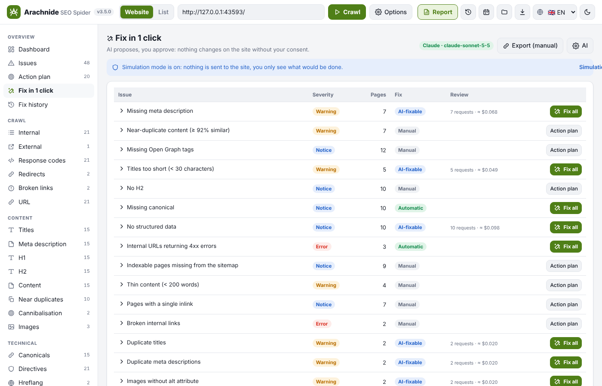
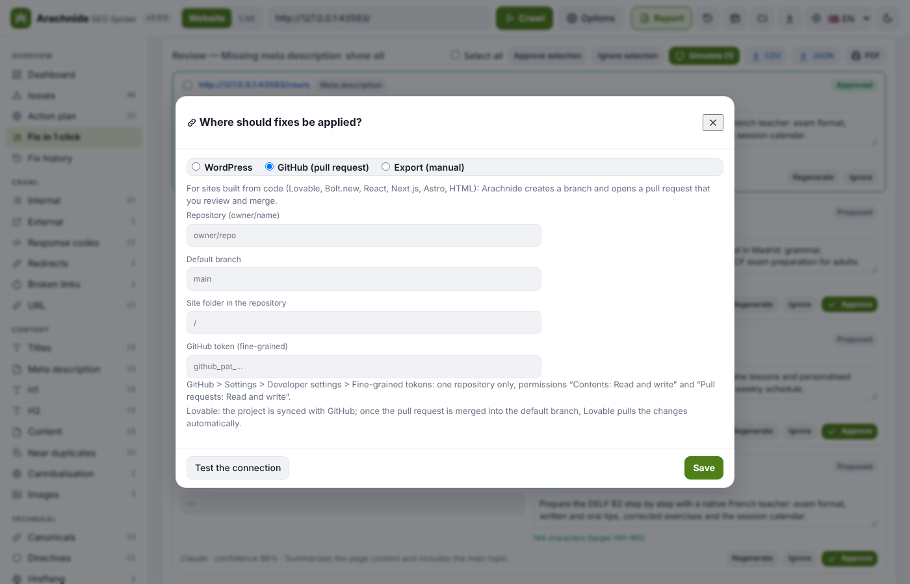

<p align="center">
  
</p>

<p align="center">
  <a href="README.md">🇬🇧 English</a> · <b>🇫🇷 Français</b> · <a href="README.de.md">🇩🇪 Deutsch</a> · <a href="README.es.md">🇪🇸 Español</a> · <a href="README.it.md">🇮🇹 Italiano</a> · <a href="README.pt.md">🇵🇹 Português</a>
</p>

<p align="center">
  <a href="LICENSE"></a>
  
  
  
  
  <a href="https://github.com/Jacckisback/arachnide-seo-spider/actions"></a>
</p>

<p align="center">🌐 Site et documentation : <a href="https://arachnide-seo.com"><b>arachnide-seo.com</b></a></p>

---

**Arachnide** est un crawler SEO technique gratuit qui tourne sur votre propre ordinateur, comme Screaming Frog SEO Spider. Il explore un site comme le fait Googlebot, **exécute le JavaScript** si vous le souhaitez, et transforme le crawl en audit priorisé :

- un score de santé sur 100 et un score par catégorie ;
- **environ 90 contrôles**, chacun avec une explication et une correction ;
- un plan d’action classé par impact et par effort ;
- un **rapport PDF en marque blanche** pour vos clients, en 6 langues.

Pas de compte, pas de cloud : vos données restent sur votre machine. Testé sur un site synthétique de 200 000 pages (`npm run bench -- --pages 200000`) ; le budget par défaut est de 500 pages, à relever dans les options.

<p align="center">
  
</p>

## 🗂️ Nouveau en 3.23 : changements de sitemap — n’auditer que les produits sortis, trancher 301 ou 410

Sur une boutique, des produits entrent et sortent chaque semaine ; recrawler tout le site pour savoir ce que sont devenus ceux qui sont partis est lent et inutile. Donnez à Arachnide le **sitemap ou l’index de sitemaps** actuel et une référence (un crawl précédent de l’historique, l’ancien sitemap, ou une liste d’URL) : il ne crawle **que les URL sorties du sitemap** (ou celles ajoutées), **suit leurs redirections** et tranche pour chacune — 301 vers une page similaire proposée (même dossier, nom proche, avec un score de similarité), 410 quand rien ne la remplace, réparer une redirection cassée ou une erreur serveur, raccourcir une chaîne, ou remettre une page encore en ligne. Nouvel onglet **Changements de sitemap** avec filtres et CSV, une carte sur le tableau de bord, six nouveaux contrôles dans le score et le rapport, une fenêtre *Options du mode liste* dans l’application, `--sitemap-previous` / `--sitemap-changes` en ligne de commande et `arachnide_sitemap_changes` pour les agents IA. L’extraction XPath et le mode liste depuis un sitemap demandés dans le même retour existent depuis la 3.21. Guide : **[docs/SITEMAP-CHANGES.fr.md](docs/SITEMAP-CHANGES.fr.md)**.

## 📜 Nouveau en 3.22 : analyse de logs — ce que Googlebot demande vraiment

Un crawl montre ce que les moteurs *pouvaient* atteindre ; les **journaux d’accès de votre serveur** montrent ce que Googlebot, Bingbot et les robots IA *demandent réellement*, à quelle fréquence, avec quel statut et en combien de temps. Arachnide lit désormais ces logs (Apache / Nginx combined et common, W3C IIS / CloudFront, JSON lignes de Nginx, Cloudflare Logpush, Caddy, Traefik, ou tout `log_format` Nginx personnalisé ; `.gz` accepté, fichiers de rotation ensemble) et les rattache au crawl ouvert, avec la même normalisation d’URL que le crawler. Nouvel onglet **Logs serveur** : requêtes par jour et par famille de robots, robots vus (avec leurs IP distinctes), dossiers les plus demandés, chaque URL vue dans les logs avec ses données de crawl et huit filtres ; une carte sur le tableau de bord ; des compteurs dans la fiche de page, les segments et le rapport client. **Six nouveaux contrôles** comptent dans le score : pages crawlées par les moteurs que rien ne lie, pages indexables que Googlebot ne visite jamais, budget de crawl gaspillé en redirections / erreurs / URL non indexables, 5xx servies aux robots, **fausses visites Googlebot** (vérification DNS inverse comme Google et Bing la documentent) et pages lentes pour les robots. Tout reste sur votre machine : les fichiers sont lus en flux ligne par ligne, seuls des comptages agrégés sont gardés à côté du crawl. CLI `--logs FICHIER` (répétable), `--logs-format`, `--logs-custom`, `--logs-verify` ; les agents IA gagnent `arachnide_logs`. Guide : **[docs/LOGS.fr.md](docs/LOGS.fr.md)**.

## 🛡️ Nouveau en 3.21 : garde-fous de crawl, XPath, mode liste par sitemap, et un benchmark reproductible à 200 000 pages

Le budget de pages compte désormais les pages réellement téléchargées (les URL bloquées par robots.txt ne le consomment plus), les paramètres d’URL sont triés et les paramètres de suivi (`utm_*`, `gclid`, `fbclid`…) retirés par défaut, les pièges à facettes sont signalés, un robots.txt injoignable interdit tout comme l’exige la RFC 9309 (avec une sortie explicite), robots.txt est lu par hôte en mode liste, les 5xx et coupures réseau ont une nouvelle tentative différée, les corps de réponse sont lus en flux et bornés, un Chrome qui meurt est relancé et signalé, et une extraction regex emballée est interrompue dans un worker. L’**extraction XPath** rejoint CSS et regex (Chrome en rendu, jsdom facultatif sur le HTML brut) ; la CLI gagne les cibles `attr:` / `html:` / `count:` / `xpath:` avec une colonne CSV par règle, **`--sitemap URL`** crawle exactement un sitemap, le mode liste monte à 500 000 URL et les agents IA ont aussi le mode liste. `npm run bench -- --pages 200000` crawle un site synthétique local et affiche durée, mémoire maximale et taille du fichier.

## 🖥️ Nouveau en 3.20 : passage à l’échelle, étape 5 — le navigateur ne reçoit plus jamais le crawl entier

Le serveur garde le crawl et son graphe de liens ; le navigateur reçoit un **résultat léger en flux** (pages réduites à ce que les tableaux affichent, sans les liens) et demande le reste à la demande : les liens d’une page **paginés** dans le panneau de détail (plus de coupure silencieuse à 1 000), la fiche complète au clic, les arêtes de la carte pour les seuls nœuds affichés, et la comparaison avec le crawl précédent sous forme d’un petit diff calculé côté serveur. Ouvrir un crawl enregistré ou importer un fichier ne fait plus d’aller-retour du crawl ; les exports partent du serveur en flux. Les comptes des onglets sont calculés une fois par résultat.

## 🔬 Nouveau en 3.19 : passage à l’échelle, étape 4 — une analyse qui passe à l’échelle

**Toutes les pages sont désormais comparées pour les quasi-doublons** : l’ancien contrôle s’arrêtait aux 5 000 premières pages sans le dire. La recherche est exacte par bandes sur l’empreinte de 64 bits (deux pages à 5 bits d’écart partagent toujours une bande) : un site de 200 000 pages est comparé en quelques secondes, et un site très gabarité est signalé plutôt que tronqué en silence. La **cannibalisation** se calcule en temps linéaire avec un index inversé, et les expressions partagées par plus de 500 pages sont signalées comme gabarit du site. Les **segments** comptent leurs liens en un seul passage au lieu d’un par segment (475 ms contre ~16 s pour 10 segments sur 20 millions de liens), et les règles de correction lisent le graphe compact.

## 💾 Nouveau en 3.18 : passage à l’échelle, étape 3 — un crawl écrit au fil de l’eau

Un crawl ne passe plus jamais par une seule chaîne. Les résultats sont enregistrés en **NDJSON gzip** (un objet JSON par ligne, les liens par paquets), écrits et relus en flux, de façon atomique ; l’historique ne lit que la première ligne. Pendant le crawl, un **journal de reprise** note chaque URL mise en file et chaque page traitée : après un plantage ou un Ctrl+C, `--resume` (ou `POST /api/crawl { resume }`) reprend le crawl là où il s’est arrêté, en ne perdant que les dernières secondes. Les crawls enregistrés sont envoyés au navigateur ligne par ligne, les segments modifiés après coup vont dans un petit fichier voisin, et la ligne de commande écrit JSON, CSV et rapport chacun en flux et indépendamment. Les anciens crawls `.json` s’ouvrent toujours. Étape suivante : des pages allégées et des liens à la demande dans le navigateur.

## 🧮 Nouveau en 3.17 : passage à l’échelle, étape 2 — un graphe de liens compact

Un lien était un objet JavaScript de sept propriétés avec deux chaînes d’URL ; l’analyse le recopiait ensuite dans des Map de Set puis dans un tableau de tuples. Les liens vivent désormais en **colonnes d’entiers** (URL et textes d’ancre stockés une fois, 14 octets par lien) et l’analyse travaille sur un **graphe CSR** : liens entrants, profondeur de clic, PageRank et contrôles de liens lisent les mêmes colonnes, sans aucun objet par lien. Mesuré sur 50 000 pages × 100 liens : stockage des liens 690 Mo → 55 Mo, analyse 29 s / 2,5 Go → 5,5 s / 647 Mo, résultats identiques. Un crawl de 200 000 pages et 20 millions de liens passe maintenant l’analyse. Le bloc `links` enregistré est en colonnes ; les anciens fichiers s’ouvrent toujours. Étape suivante : écrire le fichier et les données du navigateur en flux.

## 🏗️ Nouveau en 3.16 : passage à l’échelle, étape 1 — les gros sites ne plantent plus à la fin

Une revue technique sur un crawl de 200 000 pages a montré que le moteur tient la charge, mais pas quelques lignes de traitement des données : un `Math.min(...)` sur une valeur par URL faisait planter l’analyse au-delà de ~125 000 URL (après des heures de crawl), et plusieurs boucles étaient quadratiques. **Quatorze correctifs** : plus de spread sur des tableaux à la taille du site, index construits une fois (redirections, liens sortants, URL la plus proche d’une 404 en cherchant d’abord dans le dossier parent), exemples donnés à l’IA pris dans le même dossier, tri des tableaux 20× plus rapide (un seul `Intl.Collator`), comptage des dossiers de la carte 5× plus rapide, tâches de crawl terminées réduites à un condensé, et **écritures atomiques** : un arrêt pendant la sauvegarde ne laisse plus jamais un crawl tronqué. Les étapes suivantes compacteront le stockage des liens et écriront le fichier et les données du navigateur en flux.

## 📊 Nouveau en 3.15 : Google Analytics 4 — les pages orphelines qui font du trafic

Connectez **Google Analytics 4** (API avec un compte de service, ou export CSV « Pages et écrans ») pour voir les sessions de chaque page et attraper ce qu’un crawl seul ne voit pas : les **pages orphelines qui reçoivent des visites** (landing pages de campagne, anciennes URL, pages présentes seulement dans le sitemap), les **pages en erreur encore visitées**, les pages non indexables avec du trafic et celles que personne ne visite. Nouvel onglet *Google Analytics*, 4 nouveaux contrôles, *Sessions GA4* dans les segments, `--ga4-key` / `--ga4-csv` en ligne de commande et prise en charge par les agents IA.

## 🧩 Nouveau en 3.14 : les segments — auditez un gros site section par section

Sur un gros site, un score global cache l’endroit où sont vraiment les problèmes. Les **segments** découpent l’audit en sections nommées — fiches produit, catégories, blog, une langue, les pages sans trafic… — exactement comme les segments de Screaming Frog.

- **Des règles sur n’importe quel champ** : chemin, URL, title, H1, meta description, statut, indexabilité, profondeur de clic, nombre de mots, liens entrants, Link Score, temps de réponse, sitemap, type de données structurées, langue, clics Search Console, et vos **extractions personnalisées** (`extract:Prix`…). Opérateurs texte (contient, commence par, regex…), nombres (>, ≤…), vrai / faux. Règles combinées en ET / OU.
- **Le premier segment qui correspond l’emporte**, comme dans Screaming Frog : ordonnez vos segments, le reste va dans *Sans segment*. Le nombre de pages s’affiche en direct pendant l’édition.
- **Démarrage en un clic** : *Créer depuis les répertoires* crée un segment par dossier de premier niveau (et descend d’un niveau quand un seul dossier contient tout le site, ex. `/fr/`).
- **Appliqués après le crawl, sans recrawler** : créez, modifiez ou réordonnez vos segments à tout moment. Ils sont enregistrés avec le crawl et repris pour les prochains crawls du site. Import / export JSON pour les partager en équipe.
- **Un filtre global** dans la barre latérale : choisissez un segment et *toute* l’application suit — vue d’ensemble, score de santé et piliers, problèmes SEO, plan d’action, tous les tableaux, exports CSV et rapport PDF — recalculés pour cette section avec exactement la même méthode de score.
- **Un tableau des segments sur la vue d’ensemble** : pages, score de santé, erreurs, avertissements, indexabilité, profondeur, mots, Link Score, temps de réponse et problèmes principaux de chaque section. Un clic sur une ligne filtre tout l’audit.
- **Chaque problème réparti par segment**, une colonne *Segment* dans les tableaux et les CSV, *Couleur par segment* sur la cartographie (le segment filtré est mis en avant, le reste du site reste visible).
- **Ligne de commande** : `--segments segments.json`, `--segment-folders`, `--segment blog`. **Agents IA** : nouvel outil `arachnide_segments` (get / suggest / set) et un paramètre `segment` sur le résumé, les problèmes, le plan d’action, la recherche de pages et le rapport GEO.

<p align="center">
  
</p>

## 🤝 Nouveau en 3.13 : branchez votre propre agent IA (Claude, ChatGPT…) sur Arachnide

Arachnide devient les yeux et les mains de votre agent SEO / GEO. L’agent lit l’audit que vous avez ouvert, lance des crawls qui s’affichent en direct dans l’application, explore les pages, obtient le plan d’action priorisé et le nouveau rapport de **préparation GEO**, et corrige le site avec votre accord.

- **Trois portes, 25 outils** : MCP en stdio (Claude Code, Claude Desktop), **MCP en HTTP** (`/mcp`, pour les connecteurs personnalisés claude.ai et les agents hébergés) et **REST + OpenAPI 3.1** (`/api/agent/*`, `/openapi.json` — à importer en un clic comme Action ChatGPT). Les mêmes outils partout, définis une seule fois.
- **Jeton d’accès** créé au premier démarrage, affiché et renouvelable dans *Paramètres → Agents IA*, avec des extraits prêts à coller (config Claude Desktop, réglages de l’Action ChatGPT, requête de test), un champ d’URL publique pour les tunnels (cloudflared, ngrok, Tailscale) et le journal des derniers appels d’agents.
- **Nouveaux outils** : `arachnide_action_plan` (le plan ordonné de l’app, gains rapides signalés), `arachnide_search_pages` (filtrer et trier les pages par Link Score, profondeur, statut, dossier, problème), `arachnide_geo_readiness` (accès des robots IA, llms.txt, données structurées, profondeur du contenu → score 0-100 et recommandations), `arachnide_start_crawl` + `arachnide_crawl_status` (crawl en arrière-plan, visible en direct dans l’app). `crawl_id: "current"` désigne toujours l’audit ouvert dans l’app.
- Guide et instructions suggérées pour un agent SEO / GEO : [docs/AGENTS.fr.md](docs/AGENTS.fr.md).

## 🎨 Nouveau en 3.12 : une passe de design sur toute l’application

Un audit complet UX, couleurs et typographie de chaque page, dans les deux thèmes, sur ordinateur et sur mobile — puis les corrections.

- **Une vraie typographie** : la police Inter Variable est désormais embarquée (hors ligne, licence SIL OFL), donc chaque graisse s’affiche pareil sur toutes les machines ; 23 tailles de texte éparses deviennent une échelle de 8 crans, avec titres, arrondis et espacements cohérents.
- **Thème clair lisible** : tous les textes colorés (avertissements, états OK, liens, libellés secondaires, badges d’effort) atteignent le contraste WCAG AA (4,5:1) sur les fonds où ils sont posés — 103 défauts mesurés ramenés à 0.
- **Détails plus fluides** : la page Corrections fonctionne sur un crawl ouvert depuis un fichier ; le panneau de détail d’une page ne reste plus affiché sur les pages sans tableau ; la ligne sélectionnée d’un tableau est marquée proprement ; le bouton de thème montre ce qu’il va faire ; l’interrupteur de simulation est de nouveau visible.

## 🧭 Nouveau en 3.11 : cartographie et visualisation 2D / 3D, côte à côte

- **Cartographie** (barre latérale) : le plan du site classique, façon Screaming Frog — fond blanc, arbre horizontal, pensé pour les captures et les rapports clients.
- **Visualisation 2D / 3D** (nouvel onglet, juste en dessous) : la vue d’exploration — style sombre, disposition radiale, en 2D ou en 3D, colorée par problèmes SEO par défaut.
- Les deux vues partagent les mêmes données, filtres, recherche et inspecteur de page ; chacune garde ses propres réglages.

## 🌳 Nouveau en 3.10 : une cartographie classique, prête à montrer

Une cartographie plus lisible, à montrer telle quelle à un client ou à un manager — et un contrôle plus fin de ce que vous crawlez et cartographiez.

<p align="center"></p>

- **Style classique (nouveau par défaut)** : fond blanc, liens fins, libellés foncés — dans l’esprit de l’arbre de crawl de Screaming Frog. Le style *Sombre* reste à un clic, en 2D comme en 3D.
- **Arbre horizontal** : l’accueil à gauche, une colonne par niveau, un libellé par page. Les longues listes sont résumées (« + 28 autres pages », les problèmes des pages masquées restent signalés) et *Afficher toute la liste* les déplie ; la page sélectionnée reste toujours visible. En *Répertoires*, chaque dossier affiche son chemin relatif au dossier parent, comme un explorateur de fichiers.
- **Exports prêts à envoyer** : le PNG / PDF a désormais un en-tête (site, vue, date du crawl, pages affichées), la légende et le contexte.
- **Aucune URL inventée** : en *Répertoires*, une page comme `/en` porte désormais son dossier `/en/` au lieu d’afficher une fausse URL `/en/` à côté ; un dossier sans page à son adresse est présenté comme un regroupement (`/blog/page/*`).
- **Inclure / exclure des URL dans la carte** : un motif par ligne — texte (`/en/`), joker (`/en/*/page-*`) ou expression régulière (`/en/(.*)`). Le filtre *Dossier* fonctionne désormais à tous les niveaux (`/en/blog/`).
- **Périmètre du crawl** : inclure / exclure acceptent une regex par ligne, et la nouvelle option *Rester dans le dossier de départ* ne crawle que sous le dossier de l’URL de départ (comme « Crawl Outside of Start Folder » décoché dans Screaming Frog). En ligne de commande : répétez `--include` / `--exclude`, ajoutez `--stay-in-folder`.
- **Plus robuste** : une URL de départ invalide (`htp:/x`, `javascript:…`, un simple nombre) est refusée avec un message clair, les nombres absurdes sont ramenés à des bornes sûres, un crawl impossible à enregistrer le signale. De nouveaux tests de bout en bout et « singe » pilotent la vraie interface dans un navigateur (clics au hasard, saisies absurdes, redimensionnements) à chaque lancement des tests.

## 🕸️ Nouveau en 3.9 : une cartographie plus rapide et plus lisible

Explorez la structure et repérez les pages à améliorer, en 2D ou en 3D, sur des milliers de pages.

<p align="center"></p>

- **Trois vues réellement différentes** : *Arbre de crawl* (chaque page sous la page qui l’a fait découvrir sur le plus court chemin depuis l’accueil — le chemin affiché correspond toujours à la profondeur en clics), *Répertoires* (chemins d’URL, avec des dossiers virtuels non comptés comme des pages) et *Maillage* (les liens réellement observés, orientés, cycles compris).
- **Inspecteur de page** : statut, indexabilité (seulement si elle est connue), profondeur, Link Score, pages sources, liens sortants, chemin de découverte, problèmes et recommandation existante, avec *Isoler la branche / le voisinage*, *Voir les liens internes* et *Voir le plan d’action*.
- **Recherche, filtres et analyses** sur toutes les pages du crawl (pas seulement celles dessinées) : problèmes SEO, profondeur, répertoire, statut HTTP, indexabilité, faible maillage entrant avec seuil explicite, plage de Link Score — en surbrillance dans le contexte ou isolées. Les exports (PNG, PDF, CSV) gardent libellés, légende et contexte ; une vue *Liste* permet tout au clavier.
- **Beaucoup plus rapide** : placement déterministe au lieu d’une simulation physique pour les arbres, nœuds et liens dessinés en quelques lots, rendu seulement quand quelque chose change. Mesuré sur la même machine (rendu logiciel) : stabilisation 3D de 5,5–13,9 s à 0,7–3,2 s, fluidité 3D en rotation de 1–11 à 46–60 images/s.

## 🗺️ Nouveau en 3.8 : un plan d’action sur lequel travailler

Sachez quoi corriger, dans quel ordre et comment, et suivez votre avancement.

<p align="center"></p>

- **Quatre cartes** : actions à traiter (par gravité), gains rapides (effort faible, impact moyen ou élevé), effort de correction et **Commencez ici**, la première action du classement recommandé.
- **Feuille de route** : chaque problème devient une action avec un verbe clair (« Raccourcir les titres », « Vérifier les liens en nofollow »), son rang, sa gravité, son impact SEO, ses URL uniques, son effort et son statut. Filtres (tout, gains rapides, à faire, à vérifier, autres états), recherche, et un tri manuel qui remplace clairement le classement recommandé jusqu’à ce que vous y reveniez.
- **Fiche d’action** : pourquoi commencer ici (uniquement des faits du crawl), méthode numérotée, critère « Terminé quand… », voir / exporter les URL, une note, et **Démarrer cette action → Marquer comme terminée → Relancer le crawl pour valider**. Seul un nouveau crawl qui ne détecte plus le problème le marque comme résolu.
- **Suivi** (statut et notes) enregistré dans votre navigateur pour chaque site ; la sélection multiple permet d’exporter les URL de plusieurs actions ou de changer leur statut d’un coup.

## 🧭 Nouveau en 3.7 : une page Problèmes SEO plus claire

Du diagnostic à la correction sur un seul écran : ce qui a été détecté, quoi corriger d’abord, la gravité, le nombre d’URL concernées et l’effort estimé.

<p align="center"></p>

- **Cartes de synthèse** : types de problèmes au total, erreurs, avertissements et informations (jamais une somme d’URL). Un clic sur une carte filtre la liste.
- **Liste priorisée** : onglets de gravité, recherche et tri (priorité recommandée par défaut, avec sa règle expliquée). URL uniques par problème, effort distinct de la gravité, pagination et navigation au clavier.
- **Panneau de correction** : pourquoi corriger, étapes numérotées, exemple avant / après tiré d’une vraie page (avec une suggestion automatique clairement signalée pour les titres et descriptions trop longs), aperçu des URL, **Voir les N URL** et **Exporter la liste**.
- **Les erreurs passent toujours en premier** dans la priorité recommandée, le plan d’action et la vue d’ensemble.
- Deux colonnes sur grand écran, vue détail dédiée sur mobile.

## 🌙 Nouveau en 3.6 : tableau de bord en mode sombre

La vue d’ensemble répond d’un coup d’œil à une question : où en est mon site, et que faire ensuite ? (capture en haut de cette page)

- **Santé SEO en quatre anneaux** : Technique, Contenu, Maillage et Performance. Chaque arc correspond exactement au score du pilier ; un clic ouvre les problèmes correspondants. Un pilier sans données est indiqué « Non mesuré ».
- **Vos priorités** : les 3 premières actions, comptées en pages uniques, avec un lien vers le plan d’action.
- **Indicateurs clés**, **Ce qui fonctionne bien** et **Votre prochain objectif**, plus un bandeau quand l’audit est partiel.
- Nouvelle barre latérale (Pilotage / Exploration), barre supérieure avec l’état du crawl et « Relancer le crawl », thème sombre par défaut.

## ✨ Nouveau en 3.5 : corriger en 1 clic avec Claude ou ChatGPT

Après un crawl, ouvrez l’onglet **Corriger en 1 clic** : les problèmes sont groupés par impact (pages × gravité), avec un badge **Corrigeable par IA**, **Automatique** ou **Manuel**.

<p align="center"></p>

1. **Corriger** une URL ou **Tout corriger** pour un type de problème : Claude ou ChatGPT rédige titles, meta descriptions, H1, textes alternatifs et JSON-LD dans la langue de la page, à partir de son vrai contenu (le coût estimé est affiché avant). Les redirections 301 des 404 internes, les canonicals, les noindex accidentels et les liens vers des redirections sont calculés sans IA. Les problèmes de performance ou d’hébergement reçoivent un plan d’action écrit, jamais un bouton « Appliquer ».
2. **Revue** : avant / après côte à côte, compteur de caractères par rapport à la longueur cible, édition directe, Valider / Régénérer / Ignorer, sélection multiple.
3. **Application** sur WordPress (plugin compagnon) ou sur un dépôt de code GitHub (Pull Request : Lovable, Bolt.new, React, Next.js, Astro, HTML), ou export CSV / JSON / PDF pour tout autre CMS. **Le mode simulation est activé par défaut** : rien n’est envoyé tant que vous ne l’avez pas désactivé en acceptant l’avertissement.
4. Chaque URL corrigée est **recrawlée** (vérifiée ✓) et l’onglet **Historique des corrections** permet d’annuler une correction ou un lot entier, et d’exporter le PDF « Corrections appliquées ».

<p align="center"></p>

**L’IA ne modifie jamais votre site d’elle-même** : elle propose, vous validez, un connecteur applique, Arachnide vérifie — et tout peut être annulé.

### Mise en route

- **Clé IA** — *Options → IA* : choisissez Claude (Anthropic) ou ChatGPT (OpenAI), collez votre clé API ([console.anthropic.com](https://console.anthropic.com/settings/keys) ou [platform.openai.com](https://platform.openai.com/api-keys)), choisissez un modèle, cliquez sur *Tester la connexion*. La clé est chiffrée et stockée uniquement sur votre ordinateur, envoyée seulement à ce fournisseur ; vous le payez directement.
- **WordPress** — dans l’onglet *Corriger*, bouton de connexion → *WordPress* → *Télécharger le plugin WordPress (.zip)*, puis dans WordPress *Extensions → Ajouter → Téléverser une extension*. Créez un **mot de passe d’application** dans *Utilisateurs → Profil → Mots de passe d’application* (nommez-le « Arachnide », copiez-le) et saisissez l’adresse du site, l’identifiant et ce mot de passe dans Arachnide. Un compte Éditeur suffit pour les contenus ; Administrateur pour les redirections. Compatible Yoast SEO, Rank Math, SEOPress, All in One SEO et Redirection.
- **GitHub / Lovable** — créez un **token fine-grained** dans *GitHub → Settings → Developer settings → Personal access tokens → Fine-grained tokens* : *Only select repositories* (un seul dépôt), permissions *Contents : Read and write* et *Pull requests : Read and write*. Saisissez `propriétaire/dépôt` et le token. Arachnide ouvre une Pull Request sur `arachnide/fix-AAAAMMJJ-HHMM` après vous avoir montré le diff ; avec Lovable, la fusion dans la branche par défaut met le projet à jour automatiquement.

Fonctionnement des connecteurs et ajout d’un CMS : [docs/CONNECTORS.md](docs/CONNECTORS.md).

<p align="center"></p>

## 🔎 Nouveau en 3.4 : la fiabilité, jusqu’au bout

- **Redirections JavaScript** détectées au rendu : traitées comme des redirections, cible explorée.
- **Liens regroupés par page et cible**, avec toutes leurs ancres, au lieu d’une ligne par ancre.
- **Comparaison de crawls URL par URL** : « corrigé » seulement si l’URL a été recrawlée sans le problème, avec un avertissement quand les deux crawls ne sont pas comparables.
- **Versions hreflang explorées et vérifiées** : cibles en erreur, redirigées ou non indexables signalées.

## 🛡️ Nouveau en 3.3 : audit de fiabilité

Un audit complet (extraction HTML, moteur de crawl, règles SEO et crawls de 8 vrais sites) a supprimé les faux positifs et les faux négatifs qui pouvaient tromper un professionnel du SEO ou du GEO.

- **Sites protégés contre les robots** (403 sur le user-agent du crawler) : le crawl passe automatiquement sur Chrome et vous le signale, au lieu d’afficher toutes les pages en erreur.
- **Limitation de débit (429/503)** : Arachnide attend et réessaie, les pages freinées ne sont plus comptées comme cassées. Les liens vers LinkedIn ou des sites protégés par Cloudflare sont « non vérifiables », pas « cassés ».
- **Directives lues comme Google** : `max-image-preview:none` n’est pas un noindex, le `X-Robots-Tag` d’un autre robot est ignoré, le meta refresh est une redirection.
- **Le contenu tel qu’il est** : `<title>` des SVG ignorés, `alt=""` = image décorative, images en lazy-load (`data-src`) analysées, comptage des mots en chinois, japonais et thaï.
- **International et données structurées** : hreflang vérifiés avec les vrais codes ISO, traductions et pages paginées non considérées comme doublons, seules les propriétés schema.org exigées par Google sont contrôlées.
- **Un score de santé plus juste** : un lien cassé dans le menu ne met plus le site à 0, et un site qui bloque Googlebot n’obtient plus un A.
- **Nouveaux contrôles** : soft 404, canonical hors du `<head>`, sitemap sur un autre hôte, URL non vérifiables.

## 📈 Nouveau en 3.2 : données Google et crawls planifiés

- **Core Web Vitals des vrais visiteurs** (PageSpeed Insights + CrUX : LCP, INP, CLS…) et score Lighthouse de vos pages clés.
- **Google Search Console** : clics, impressions, CTR et position par URL, par l’API ou par import CSV. Repère aussi les **pages vues par Google mais que vos liens n’atteignent pas**, les CTR faibles et les pages non indexables qui ont du trafic.
- **Crawls planifiés** (jour / semaine / mois) avec **alertes e-mail** quand le score baisse ou que des erreurs apparaissent, rapport complet en pièce jointe.

Mise en place en 5 minutes : **[docs/GOOGLE-AND-SCHEDULES.md](docs/GOOGLE-AND-SCHEDULES.md)** (en anglais).

## 🤖 Nouveau dans la 3.0 : Claude audite **et corrige** votre site (MCP)

Arachnide intègre désormais un **serveur MCP**. Branchez-le sur Claude (Claude Code ou Claude Desktop) et demandez simplement : *« Audite www.mon-site.fr et corrige les titres, les descriptions et les textes alternatifs manquants des pages les plus importantes. »* Claude va :

1. **détecter** le CMS (WordPress, Shopify, Wix, Squarespace, Webflow, Joomla, Drupal, PrestaShop, site statique, Next.js…) ;
2. **crawler et auditer** le site avec Arachnide ;
3. **rédiger** de meilleures valeurs à partir du contenu réel de chaque page (titres uniques respectant la limite en pixels de Google, meta descriptions, textes alternatifs, canoniques, redirections pour les URL cassées) ;
4. vous présenter un **aperçu avant / après** et attendre votre feu vert ;
5. **appliquer** les modifications validées sur le site en ligne via l'API du CMS, les **vérifier**, et vous permettre d'**annuler** n'importe quel lot ;
6. **relancer un crawl** et vous montrer le gain de score.

| Mode d'application des corrections | Plateformes | Part de l'ensemble des sites web* |
|---|---|---:|
| API du CMS (+ petite extension WordPress) | WordPress, Shopify, Wix, Joomla, Webflow, Drupal, PrestaShop | ≈ 53 % |
| Fichiers HTML ou Cloudflare Worker | sites sans CMS (sur mesure, statiques, Next.js, Hugo…) et tout site derrière Cloudflare | jusqu'à 31,6 % |
| Instructions pas à pas | Squarespace et autres éditeurs fermés | le reste |

<sub>* W3Techs, octobre 2026.</sub>

```bash
claude mcp add arachnide -- node /path/to/arachnide-seo-spider/src/mcp.mjs
```

La sécurité avant tout : aperçu avant chaque écriture, demande d'autorisation pour chaque écriture, règles par site (champs autorisés, taille des lots, lecture seule), journal de toutes les valeurs précédentes avec retour arrière en un seul appel, et des secrets qui ne transitent jamais par la conversation. **Guide complet : [docs/MCP.fr.md](docs/MCP.fr.md)**.

## 🆕 Nouveautés de la version 2.1

| | |
|---|---|
| 🕸️ **Visualisations 2D et 3D** | Visualisez l’architecture du site en 2D ou en 3D, selon trois vues : **arbre de crawl** (chemin de clics le plus court depuis la page d’accueil), **arbre des répertoires** (structure des URLs) et **graphe des liens** (tous les liens internes suivis). Colorez les nœuds selon l’indexabilité, les problèmes SEO ou la profondeur ; la taille des nœuds reflète le Link Score. Cliquez sur un nœud pour afficher le détail de la page, et exportez la vue en PNG pour vos rapports. |
| ⚙️ **Configuration du crawler, comme dans Screaming Frog** | Une fenêtre **Configuration** organisée en onglets : Spider, **Limites**, **Vitesse**, **robots.txt**, Rendu, Inclure / exclure, Extraction, Authentification. Elle ne garde que les réglages utiles. |
| 🚧 **Spider › Limites** | Total du crawl, profondeur de crawl, URLs par niveau de profondeur, profondeur de dossiers, nombre de paramètres d’URL, redirections suivies, longueur d’URL, liens par page, poids de page, et **limites par chemin d’URL** (`/blog/ = 200`). Le tableau de bord indique combien d’URLs chaque limite a écartées. |
| 🤖 **robots.txt** | Trois modes : **respecter**, **ignorer mais signaler** (les URLs bloquées sont explorées tout en restant signalées) et **ignorer**. Collez un **robots.txt personnalisé** pour tester un nouveau fichier avant de le mettre en ligne, et utilisez le **testeur** intégré pour savoir si une URL est autorisée et quelle règle s’applique. |
| 🐢 **Vitesse** | Nombre maximal de threads et plafond global d’**URLs max par seconde**, pour ménager les serveurs fragiles. |
| 🧲 **Extraction personnalisée** | Récupérez n’importe quelle donnée dans chaque page avec un sélecteur CSS ou une regex : prix, auteur, date, référence (SKU), code de suivi… Les résultats apparaissent dans un onglet **Extraction** et dans l’export CSV. |
| 🔐 **Authentification et nettoyage des URLs** | Authentification HTTP et en-têtes ou cookies personnalisés pour les sites de préproduction. Ils ne sont envoyés qu’au site audité, et le mot de passe n’est jamais enregistré. **Supprimez des paramètres d’URL** comme `utm_*`, `gclid` ou `fbclid` pour éviter les URLs en double. |

<p align="center">
  
</p>

## ✨ Nouveautés de la version 2.0

| | |
|---|---|
| 🌍 **6 langues** | L’application, les exports CSV et les rapports sont disponibles en anglais, français, allemand, espagnol, italien et portugais, avec un sélecteur de langue dans l’en-tête. |
| ⚙️ **Rendu JavaScript** | Auditez les sites React, Vue, Angular et Next.js tels que Google les voit. Arachnide utilise le Chrome ou l’Edge déjà installé sur votre ordinateur : rien d’autre à télécharger. Il compare le HTML brut à la page rendue et mesure le **LCP et le CLS**. |
| 📄 **Rapports SEO pro** | Un rapport d’audit en marque blanche avec votre logo, votre couleur et vos coordonnées. Il contient une synthèse, les constats clés, les scores par catégorie, un plan d’action priorisé, une analyse détaillée et **l’évolution depuis le dernier audit**. Imprimez-le en PDF en un clic. [Voir un exemple de rapport (PDF)](docs/sample-report.pdf). |
| 🎯 **Plan d’action** | Chaque problème est classé selon gravité × impact × nombre d’URLs ÷ effort, et les gains rapides (quick wins) sont mis en avant. |
| 🧠 **Nouvelles analyses SEO** | PageRank interne (Link Score), contenu quasi dupliqué (simhash), cannibalisation de mots-clés, largeur des titles et descriptions en pixels, liens contextuels vs liens de menu et de pied de page, ancres génériques, hiérarchie des titres, données structurées incomplètes, validation hreflang, compression, HSTS, etc. |
| 🤖 **IA & GEO** | Indique si ChatGPT, Claude, Perplexity, Google-Extended et d’autres crawlers d’IA peuvent accéder au site, et si celui-ci possède un fichier `llms.txt`. |
| 📋 **Mode liste** | Auditez uniquement une liste d’URLs que vous collez, sans suivre les liens. |
| 🔎 **Recherche personnalisée** | Trouvez toutes les pages qui contiennent un texte ou une regex, par exemple un ancien numéro de téléphone ou un code de suivi. |
| 🎨 **Nouveau design** | Écran d’accueil avec les crawls récents, progression en direct avec vitesse et temps restant, panneau de détail redimensionnable, navigation au clavier (↑ ↓ Entrée, `/` pour rechercher), notifications et mode sombre. |

## 🔍 Tout ce qu’Arachnide contrôle

| Domaine | Contrôles |
|---|---|
| **Codes de réponse** | 2xx / 3xx / 4xx / 5xx, délais dépassés, URLs bloquées par le robots.txt, liens internes et externes cassés |
| **Redirections** | Chaînes, boucles, redirections temporaires 302/307, meta refresh, redirections vers la page d’accueil (soft 404), liens internes pointant vers des redirections |
| **Titles & metas** | Manquants, dupliqués, trop longs (en pixels), trop courts ou multiples ; title identique au H1 ; aperçu dans la SERP Google |
| **Titres Hn** | H1 manquant, dupliqué ou multiple ; aucun H2 ; niveaux de titres sautés |
| **Contenu** | Nombre de mots, contenu pauvre, doublons exacts et quasi-doublons, cannibalisation de mots-clés, mot-clé principal par page, ratio texte |
| **Images** | Texte alternatif manquant, images lourdes, images cassées, width/height manquants (CLS), chaque fichier des `srcset` et `<picture>` contrôlé (poids, statut, format), pas de version responsive, pas de WebP / AVIF, `srcset` sans `sizes` |
| **Indexation** | Canonicals (manquantes, multiples, pointant vers une URL non indexable), noindex, nofollow, X-Robots-Tag |
| **Architecture** | Profondeur de clic, Link Score (PageRank interne), pages orphelines, pages avec un seul lien entrant ou sans lien contextuel, pages inaccessibles |
| **Sitemaps** | Sitemap manquant, URLs non indexables dans le sitemap, pages indexables absentes du sitemap |
| **International** | Codes hreflang invalides, liens de retour manquants, auto-référence manquante, x-default manquant |
| **Données structurées** | Types détectés (JSON-LD, microdonnées), JSON-LD invalide, propriétés manquantes pour les résultats enrichis (Article, Product, FAQPage, LocalBusiness, Course, Event…) |
| **JavaScript** | Contenu, liens, title, H1, canonical ou noindex modifiés par JavaScript ; erreurs JS ; LCP et CLS |
| **Performance & sécurité** | Temps de réponse, poids du HTML, compression, HTTPS, HSTS, contenu mixte |
| **URLs** | Majuscules, underscores, paramètres, accents, longueur |
| **IA & GEO** | Accès pour Googlebot, Bingbot, GPTBot, OAI-SearchBot, ClaudeBot, PerplexityBot, Google-Extended… ; llms.txt |

## 📸 Captures d’écran

| Problèmes et corrections | Plan d’action priorisé |
|---|---|
|  |  |
| **Aperçu SERP Google (largeur en pixels)** | **Maillage interne, Link Score et liens entrants** |
|  |  |
| **Réglages du rapport en marque blanche** | **Rapport d’audit professionnel** |
|  |  |
| **Arbre de crawl (2D)** | **Graphe des liens (2D)** |
|  |  |
| **Arbre des répertoires** | **Extraction personnalisée** |
|  |  |
| **Configuration › Limites** | **Configuration › robots.txt (avec testeur)** |
|  |  |
| **Écran d’accueil** | **Mode sombre** |
|  |  |

## 🚀 Installation

### 1. Installer Node.js

Téléchargez la version **LTS** sur **[nodejs.org](https://nodejs.org)** et installez-la comme n’importe quel autre programme. Il faut la version 18.17 ou plus récente ; la dernière LTS est recommandée. Pour vérifier votre version, ouvrez un terminal et tapez `node -v`.

Pour le **Rendu JavaScript**, il vous faut aussi Google Chrome, Microsoft Edge, Chromium ou Brave. Arachnide trouve le navigateur automatiquement.

### 2. Télécharger Arachnide

- **Le plus simple :** cliquez sur le bouton vert **`<> Code`** en haut de cette page, puis sur **Download ZIP**, et décompressez le fichier.
- **Avec Git :**
  ```bash
  git clone https://github.com/Jacckisback/arachnide-seo-spider.git
  ```

### 3. Le lancer

**Option A : double-clic.** Le lanceur installe ou met à jour tout ce qu’il faut, puis ouvre votre navigateur.

| Système | Fichier à double-cliquer |
|---|---|
| macOS | `start-mac.command`. La première fois, faites un clic droit dessus et choisissez **Ouvrir**, car macOS bloque les scripts non signés. |
| Windows | `start-windows.bat` |
| Linux | `start-linux.sh` |

**Option B : terminal**

```bash
cd arachnide-seo-spider
npm install
npm start
```

Ouvrez ensuite **http://localhost:4000**. Saisissez l’adresse d’un site et cliquez sur **Crawler**.

Laissez la fenêtre du terminal ouverte pendant que vous utilisez l’application, et appuyez sur `Ctrl + C` pour l’arrêter. Si le port 4000 est occupé, Arachnide choisit le port libre suivant et l’affiche dans le terminal.

**Mise à jour depuis la 1.x :** téléchargez la nouvelle version (ou lancez `git pull`), puis relancez `npm install`. Les lanceurs par double-clic le font pour vous.

## 📄 Créer un rapport client

1. Crawlez le site.
2. Cliquez sur **Rapport**. Choisissez la langue du rapport, puis ajoutez votre logo, votre couleur de marque, le nom du client et vos coordonnées. Vos réglages sont mémorisés.
3. Si vous le souhaitez, choisissez un **crawl précédent du même site** pour montrer son évolution : variation du score, problèmes corrigés et nouveaux problèmes.
4. Cliquez sur **Générer le rapport**, puis sur **Imprimer / Enregistrer en PDF**.

Utilisez **Tous les problèmes (CSV)** pour donner à votre client ou à votre développeur la liste complète des URLs à corriger.

## ⚙️ Configuration

Cliquez sur **⚙ Options** pour ouvrir la fenêtre **Configuration**. Vos réglages sont mémorisés, sauf le mot de passe.

| Onglet | Réglages |
|---|---|
| Spider | Lire les sitemaps XML, suivre les canonicals, inclure les sous-domaines, vérifier les liens externes et les images |
| Limites | Total du crawl, profondeur de crawl, URLs par niveau de profondeur, profondeur de dossiers, paramètres d’URL, redirections suivies, longueur d’URL, liens par page, poids de page, limites par chemin d’URL (`/blog/ = 200`, une par ligne) |
| Vitesse | Nombre max. de threads, URLs max par seconde, délai d’attente |
| robots.txt | Respecter / ignorer mais signaler / ignorer, robots.txt personnalisé, testeur d’URL |
| Rendu | Rendu JavaScript, user-agent (Arachnide, Googlebot desktop/smartphone, Chrome), Accept-Language |
| Inclure / exclure | Regex d’inclusion / d’exclusion, suppression de paramètres d’URL (`utm_*, gclid`), ignorer tous les paramètres, recherche personnalisée |
| Extraction | Jusqu’à 20 extracteurs : sélecteur CSS (texte, attribut, HTML ou nombre) ou regex |
| Authentification | Utilisateur et mot de passe HTTP, en-têtes personnalisés (cookies, jetons) |

Utilisez le sélecteur **Site / Liste** à côté du champ d’adresse pour crawler un site entier ou seulement une liste d’URLs.

## 🕸️ Visualisations

Après un crawl, ouvrez **Visualisations** dans la barre latérale :

- **Arbre de crawl :** chaque page est reliée à la page qui l’a fait découvrir au niveau de clic précédent. Les longues branches signalent des pages profondes.
- **Répertoires :** la structure des URLs, dossier par dossier. Elle fait ressortir les sections déséquilibrées ou trop profondes.
- **Liens :** le graphe complet des liens internes. Les pages bien maillées se regroupent au centre, et les pages isolées dérivent vers la périphérie.

Basculez entre **2D** et **3D**, colorez selon l’indexabilité, les problèmes ou la profondeur, choisissez le nombre de nœuds affichés (jusqu’à 6 000), cliquez sur un nœud pour ouvrir son détail, et exportez un PNG pour vos rapports.

## 🖥️ Ligne de commande

```bash
node src/cli.mjs https://www.example.com --max 2000 --csv --report --lang fr
node src/cli.mjs https://www.example.com --render --ua googlebotMobile --report --client "ACME" --author "Your name"
node src/cli.mjs --list urls.txt --lang de --csv
node src/cli.mjs --sitemap https://www.example.com/sitemap.xml --extract "price=.price" --extract "sku=xpath://meta[@itemprop='sku']/@content" --csv
npm run bench -- --pages 200000
node src/cli.mjs https://www.example.com --report --compare crawls/previous.jsonl.gz
node src/cli.mjs --resume crawls/.en-cours/www.example.com_2026-10-21T09-00-00.ndjson --csv
node src/cli.mjs https://www.example.com --max 20000 --segments segments.json --csv --report
node src/cli.mjs https://www.example.com --ga4-key ga4-key.json --ga4-property 123456789 --csv
node src/cli.mjs https://www.example.com --logs access.log --logs access.log.1.gz --logs-verify --csv --report
node src/cli.mjs --sitemap https://www.example.com/sitemap_index.xml --sitemap-previous crawls/previous.jsonl.gz --csv
node src/cli.mjs https://staging.example.com --auth user:pass --rate 2 --robots report --path-limit "/blog/=200" --extract "price=.price" --remove-params "utm_*,gclid"
node src/cli.mjs --help
```

La CLI affiche le score et les problèmes dans votre langue. Elle enregistre le crawl au format JSON, que vous pouvez ouvrir dans l’interface avec **📂**. Avec `--csv`, elle exporte aussi les pages et les problèmes, et avec `--report`, elle génère un rapport d’audit HTML à vos couleurs, que vous pouvez imprimer en PDF.

## 🛠️ Dépannage

| Message | Solution |
|---|---|
| `cd: no such file or directory` | Vous n’êtes pas dans le bon dossier. Tapez `cd` suivi du chemin du dossier décompressé, par exemple `cd ~/Downloads/arachnide-seo-spider`. |
| `npm ERR! enoent … package.json` | Même cause : lancez `npm install` **dans** le dossier d’Arachnide. |
| `--disable-warning= is not allowed in NODE_OPTIONS` | Votre shell définit une option que votre version de Node ne prend pas en charge. Lancez `unset NODE_OPTIONS` (macOS/Linux), ou mettez Node.js à jour vers la dernière LTS. |
| Le rendu JavaScript n’est pas disponible | Installez Google Chrome. S’il est installé à un emplacement inhabituel, lancez Arachnide avec `CHROME_PATH="/path/to/chrome" npm start`. |
| Certaines pages n’ont ni H1 ni contenu | Le site construit probablement son contenu en JavaScript. Activez le **Rendu JavaScript** dans les options. |

## 🧪 Développement

```bash
npm test
```

Les tests crawlent un petit site local qui contient des erreurs SEO volontaires (`test/fixture-site.mjs`). Ils couvrent le rendu JavaScript, le mode liste, les rapports dans chaque langue et la complétude des traductions. Ils tournent sur Node 18, 20 et 22 via GitHub Actions.

```
src/
  crawler.mjs    moteur de crawl (file d’attente, concurrence, robots.txt, sitemaps, redirections, mode liste)
  renderer.mjs   rendu JavaScript avec le Chrome / Edge installé (puppeteer-core)
  parse.mjs      extraction HTML (titles, metas, titres Hn, liens, images, schema, hreflang…)
  analyze.mjs    graphe de liens, profondeur de clic, Link Score, doublons, cannibalisation, contrôles SEO
  text.mjs       mots-clés, mots vides multilingues, simhash
  pixel.mjs      largeur des titles et descriptions en pixels
  options.mjs    validation de la configuration du crawl (interface et CLI)
  server.mjs     serveur web local et API avec mises à jour en direct
  cli.mjs        interface en ligne de commande
public/
  app.js         interface web (sans framework)
  viz.js         visualisations 2D / 3D (force-graph, 3d-force-graph, servis localement)
  i18n/*.js      traductions (en, fr, de, es, it, pt)
  shared/        générateur de rapports, comparaison de crawls, parseur robots.txt, i18n, icônes (utilisés par l’interface et la CLI)
```

**Ajouter une langue :** copiez `public/i18n/en.js`, traduisez les valeurs et ajoutez la langue à `LANGS` dans `public/shared/i18n.js`. `npm test` vérifie qu’aucune clé ni aucun paramètre ne manque.

## 🗺️ Feuille de route

- [ ] Données terrain PageSpeed Insights / CrUX
- [ ] Intégration de la Google Search Console (clics et impressions par URL)
- [ ] Crawls planifiés avec alertes par e-mail
- [ ] Import d’un export CSV de la Google Search Console (pages orphelines connues uniquement de la GSC)
- [x] Extraction personnalisée (2.1)
- [x] Visualisations 2D / 3D de l’architecture du site (2.1)

Les suggestions et les pull requests sont les bienvenues. Voir [CONTRIBUTING.md](CONTRIBUTING.md).

## ⚖️ Usage responsable

Ne crawlez que des sites qui vous appartiennent ou que vous êtes autorisé à auditer. Sur les sites de vos clients, limitez-vous à 2 à 5 requêtes simultanées, et ajoutez une pause sur les hébergements mutualisés. L’interface n’écoute que sur votre ordinateur (`127.0.0.1`).

---

## 🙏 Remerciements

Arachnide ne serait pas ce qu’il est sans celles et ceux qui ont pris le temps de le tester, de le bousculer et de l’encourager, pour la plupart sur X :

- [@Loran750](https://x.com/Loran750), pour son aide incroyable, bien au-delà de ce que j’aurais osé espérer même dans mes rêves les plus fous, et pour m’avoir autant motivé.
- [@mrgris](https://x.com/mrgris), pour ses recommandations sur les contrôles d’images et pour m’avoir autant motivé dans ce projet.
- [@Mar1e](https://x.com/Mar1e), pour sa recommandation d’intégrer Google Analytics 4.
- [@effi_10](https://x.com/effi_10), pour ses recommandations sur la segmentation.
- [@EmelineRoblot](https://x.com/EmelineRoblot), pour le défi qu’elle m’a lancé : crawler plus d’un million de pages sans que ça plante.
- [@absolute_web](https://x.com/absolute_web), pour ses conseils sur la protection des e-mails Cloudflare et pour les mises à jour de l’intégration OpenAI avec les derniers modèles.
- Et évidemment mes enfants, Oliver et Alberto, de loin ma plus belle création et ma plus grande fierté.

## 👤 Auteur

<table>
  <tr>
    <td width="140" align="center">
      
    </td>
    <td>
      <h3>Thierry Gustin</h3>
      <p><b>Consultant SEO</b> freelance et professeur de français basé à <b>Madrid</b> 🇪🇸🇫🇷.<br>
      J’ai créé Arachnide pour mes propres audits SEO techniques, et je le partage librement avec la communauté SEO.</p>
      <p>
        🌐 <a href="https://thierrygustin.com">thierrygustin.com</a> — audits et conseil SEO<br>
        💼 <a href="https://www.linkedin.com/in/thierrygustin">LinkedIn</a><br>
        📚 <a href="https://laclassefrancaise.es">laclassefrancaise.es</a> · <a href="https://delfonline.es">delfonline.es</a> — cours de français et préparation au DELF / DALF / TCF
      </p>
      <p><b>Besoin d’un audit SEO complet, ou d’aide pour corriger les problèmes détectés par Arachnide ?</b> <a href="https://thierrygustin.com/contact">Contactez-moi →</a></p>
    </td>
  </tr>
</table>

Si Arachnide vous fait gagner du temps, une ⭐ sur GitHub aide beaucoup !

## 📄 Licence

[MIT](LICENSE) © 2026 Thierry Gustin. Vous êtes libre de l’utiliser, de le modifier et de le partager, y compris pour un usage commercial.

<sub>Arachnide est un projet indépendant, sans lien avec Screaming Frog Ltd. « Screaming Frog » est une marque déposée de son propriétaire.</sub>
