<p align="center">
  
</p>

<p align="center">
  <a href="README.md">🇬🇧 English</a> · <a href="README.fr.md">🇫🇷 Français</a> · <a href="README.de.md">🇩🇪 Deutsch</a> · <a href="README.es.md">🇪🇸 Español</a> · <a href="README.it.md">🇮🇹 Italiano</a> · <b>🇵🇹 Português</b>
</p>

<p align="center">
  <a href="LICENSE"></a>
  
  
  
  
  <a href="https://github.com/Jacckisback/arachnide-seo-spider/actions"></a>
</p>

<p align="center">🌐 Site e documentação: <a href="https://arachnide-seo.com"><b>arachnide-seo.com</b></a></p>

---

O **Arachnide** é um crawler de SEO técnico gratuito que funciona no seu próprio computador, tal como o Screaming Frog SEO Spider. Explora um site da mesma forma que o Googlebot, **renderiza JavaScript** se quiser e transforma o rastreamento numa auditoria com prioridades:

- uma pontuação de saúde em 100 e uma pontuação para cada categoria;
- **cerca de 90 verificações**, cada uma com uma explicação e uma correção;
- um plano de ação ordenado por impacto e esforço;
- um **relatório PDF em marca branca** para os seus clientes, em 6 idiomas.

Não há conta nem nuvem, e os seus dados ficam no seu computador. Testado num site sintético de 200 000 páginas (`npm run bench -- --pages 200000`); o orçamento por defeito é de 500 páginas, a aumentar nas opções.

<p align="center">
  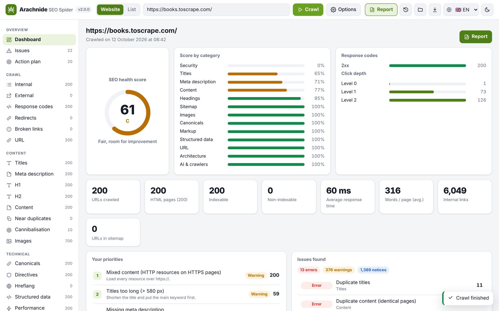
</p>

## 🗂️ Novidades da 3.23: alterações do sitemap — auditar só os produtos retirados, decidir 301 ou 410

Numa loja os produtos entram e saem todas as semanas; voltar a rastrear todo o site para saber o que aconteceu aos que saíram é lento e inútil. Dê ao Arachnide o **sitemap ou índice de sitemaps** atual e uma referência (um rastreio anterior do histórico, o sitemap antigo ou uma lista de URLs): rastreia **só os URLs que saíram do sitemap** (ou os adicionados), **segue os seus redirecionamentos** e decide para cada um — 301 para uma página semelhante proposta (mesma pasta, nome próximo, com uma pontuação de semelhança), 410 quando nada o substitui, reparar um redirecionamento quebrado ou um erro do servidor, encurtar uma cadeia, ou repor uma página ainda viva. Novo separador **Alterações do sitemap** com filtros e CSV, um cartão no painel, seis novas verificações na pontuação e no relatório, uma janela *Opções do modo lista* na aplicação, `--sitemap-previous` / `--sitemap-changes` na CLI e `arachnide_sitemap_changes` para os agentes de IA. A extração XPath e o modo lista a partir de um sitemap pedidos no mesmo comentário existem desde a 3.21. Guia: **[docs/SITEMAP-CHANGES.md](docs/SITEMAP-CHANGES.md)** (em inglês).

## 📜 Novidades da 3.22: análise de logs — o que o Googlebot pede realmente

Um rastreio mostra o que os motores *podiam* alcançar; os **registos de acesso do seu servidor** mostram o que o Googlebot, o Bingbot e os bots de IA *pedem realmente*, com que frequência, com que estado e em quanto tempo. O Arachnide lê agora esses logs (Apache / Nginx combined e common, W3C do IIS / CloudFront, JSON lines do Nginx, Cloudflare Logpush, Caddy, Traefik ou qualquer `log_format` Nginx personalizado; `.gz` aceite, ficheiros rodados em conjunto) e cruza-os com o rastreio aberto, com a mesma normalização de URL do rastreador. Novo separador **Logs do servidor**: pedidos por dia e por família de bots, bots vistos (com os seus IPs), pastas mais pedidas, cada URL vista nos logs com os dados do rastreio e oito filtros; um cartão no painel; contadores na ficha da página, nos segmentos e no relatório para o cliente. **Seis novas verificações** contam na pontuação: páginas rastreadas pelos motores que nada liga, páginas indexáveis que o Googlebot nunca visita, orçamento de rastreio desperdiçado em redirecionamentos / erros / URLs não indexáveis, 5xx servidos a bots, **visitas falsas do Googlebot** (verificação DNS inversa como a Google e o Bing documentam) e páginas lentas para os bots. Tudo fica na sua máquina: os ficheiros são lidos linha a linha em fluxo e só ficam contagens agregadas ao lado do rastreio. CLI `--logs FICHEIRO` (repetível), `--logs-format`, `--logs-custom`, `--logs-verify`; os agentes de IA ganham `arachnide_logs`. Guia: **[docs/LOGS.md](docs/LOGS.md)** (em inglês).

## 🛡️ Novidades da 3.21: salvaguardas de crawl, XPath, modo lista por sitemap e um benchmark reproduzível de 200 000 páginas

O orçamento de páginas conta agora as páginas realmente descarregadas (os URL bloqueados pelo robots.txt já não o consomem), os parâmetros de URL são ordenados e os de rastreio (`utm_*`, `gclid`, `fbclid`…) removidos por defeito, as armadilhas de facetas são assinaladas, um robots.txt inacessível proíbe tudo como exige a RFC 9309 (com uma saída explícita), o robots.txt é lido por anfitrião em modo lista, os 5xx e cortes de rede têm uma nova tentativa diferida, os corpos das respostas são lidos em fluxo e limitados, um Chrome que morre é reiniciado e assinalado, e uma extração regex descontrolada é interrompida num worker. A **extração XPath** junta-se a CSS e regex (Chrome em renderização, jsdom opcional sobre o HTML bruto); a CLI ganha os alvos `attr:` / `html:` / `count:` / `xpath:` com uma coluna CSV por regra, **`--sitemap URL`** rastreia exatamente um sitemap, o modo lista sobe a 500 000 URL e os agentes de IA também têm modo lista. `npm run bench -- --pages 200000` rastreia um site sintético local e mostra duração, memória máxima e tamanho do ficheiro.

## 🖥️ Novidades da 3.20: escala, passo 5 — o navegador nunca mais recebe o crawl inteiro

O servidor guarda o crawl e o seu grafo de links; o navegador recebe um **resultado leve em fluxo** (páginas reduzidas ao que as tabelas mostram, sem links) e pede o resto a pedido: os links de uma página **paginados** no painel de detalhe (sem corte silencioso em 1 000), a ficha completa ao clicar, as arestas do mapa só para os nós mostrados, e a comparação com o crawl anterior como um pequeno diff calculado no servidor. Abrir um crawl gravado ou importar um ficheiro já não envia o crawl de ida e volta; as exportações saem do servidor em fluxo. As contagens dos separadores são calculadas uma vez por resultado.

## 🔬 Novidades da 3.19: escala, passo 4 — uma análise que escala

**Todas as páginas são agora comparadas para quase duplicados**: a antiga verificação parava nas primeiras 5 000 páginas sem o dizer. A pesquisa é exata por bandas sobre a impressão de 64 bits (duas páginas a 5 bits de distância partilham sempre uma banda), pelo que um site de 200 000 páginas é comparado em segundos; um site muito baseado em modelo é assinalado em vez de truncado em silêncio. A **canibalização** calcula-se em tempo linear com um índice invertido, e as expressões partilhadas por mais de 500 páginas são assinaladas como modelo do site. Os **segmentos** contam os seus links numa única passagem em vez de uma por segmento (475 ms contra ~16 s para 10 segmentos em 20 milhões de links), e as regras de correção leem o grafo compacto.

## 💾 Novidades da 3.18: escala, passo 3 — um crawl escrito à medida

Um crawl nunca mais passa por uma única cadeia. Os resultados são gravados em **NDJSON gzip** (um objeto JSON por linha, os links por lotes), escritos e lidos em fluxo, de forma atómica; o histórico lê apenas a primeira linha. Durante o crawl, um **diário de retoma** regista cada URL em fila e cada página feita: após uma falha ou um Ctrl+C, `--resume` (ou `POST /api/crawl { resume }`) retoma o crawl onde parou, perdendo apenas os últimos segundos. Os crawls gravados chegam ao navegador linha a linha, os segmentos editados depois vão para um pequeno ficheiro ao lado, e a linha de comandos escreve JSON, CSV e relatório cada um em fluxo e de forma independente. Os antigos crawls `.json` continuam a abrir. Próximo passo: páginas mais leves e links a pedido no navegador.

## 🧮 Novidades da 3.17: escala, passo 2 — um grafo de links compacto

Um link era um objeto JavaScript com sete propriedades e duas cadeias de URL; a análise copiava-o depois para Maps de Sets e para um array de tuplos. Os links vivem agora em **colunas de inteiros** (URL e textos de âncora guardados uma vez, 14 bytes por link) e a análise trabalha sobre um **grafo CSR**: links de entrada, profundidade de clique, PageRank e verificações de links leem as mesmas colunas, sem nenhum objeto por link. Medido em 50 000 páginas × 100 links: armazenamento 690 MB → 55 MB, análise 29 s / 2,5 GB → 5,5 s / 647 MB, mesmos resultados. Um crawl de 200 000 páginas e 20 milhões de links já passa a análise. O bloco `links` gravado é em colunas; os ficheiros antigos continuam a abrir. Próximo passo: escrever o ficheiro e os dados do navegador em fluxo.

## 🏗️ Novidades da 3.16: escala, passo 1 — os sites grandes já não falham no fim

Uma revisão técnica num crawl de 200 000 páginas mostrou que o motor escala, mas algumas linhas de tratamento de dados não: um `Math.min(...)` sobre um valor por URL fazia falhar a análise além de ~125 000 URL (após horas de crawl), e vários ciclos eram quadráticos. **Catorze pequenas correções**: sem spread em arrays do tamanho do site, índices construídos uma só vez (redirecionamentos, links de saída, URL mais próximo de um 404 procurando primeiro na pasta mãe), exemplos para a IA tirados da mesma pasta, ordenação das tabelas 20× mais rápida (um só `Intl.Collator`), contagem das pastas do mapa 5× mais rápida, tarefas de crawl terminadas reduzidas a um resumo, e **escritas atómicas** para que uma paragem durante a gravação nunca deixe um crawl truncado. Os próximos passos vão compactar o armazenamento dos links e enviar o ficheiro e os dados do navegador em fluxo.

## 📊 Novidades da 3.15: Google Analytics 4 — páginas órfãs com tráfego

Ligue o **Google Analytics 4** (API com conta de serviço ou exportação CSV «Páginas e ecrãs») para ver as sessões de cada página e encontrar o que um rastreio sozinho não vê: **páginas órfãs que recebem visitas**, **páginas com erro ainda visitadas**, páginas não indexáveis com tráfego e páginas sem visitas. Novo separador *Google Analytics*, 4 novas verificações, *Sessões GA4* nos segmentos, `--ga4-key` / `--ga4-csv` na CLI e suporte para agentes de IA.

## 🧩 Novidades da 3.14: segmentos — audite um site grande secção a secção

Num site grande, uma pontuação global esconde onde estão realmente os problemas. Os **segmentos** dividem a auditoria em secções com nome — páginas de produto, categorias, blog, um idioma, páginas sem tráfego… — exatamente como os segmentos do Screaming Frog.

- **Regras sobre qualquer campo**: caminho, URL, title, H1, meta description, estado, indexabilidade, profundidade de clique, palavras, links de entrada, Link Score, tempo de resposta, sitemap, tipo de dados estruturados, idioma, cliques do Search Console e as suas **extrações personalizadas**. Operadores de texto, números e verdadeiro / falso, combinados em E / OU.
- **Ganha o primeiro segmento que corresponde**: ordene os segmentos, o resto vai para *Sem segmento*. Contagem de páginas em direto.
- **Um clique para começar**: *Criar a partir das pastas* cria um segmento por pasta de primeiro nível.
- **Aplicados depois do rastreio, sem novo rastreio**, guardados com o rastreio e reutilizados nos seguintes. Importação / exportação JSON.
- **Um filtro global** na barra lateral: toda a aplicação segue o segmento — visão geral, pontuação, problemas, plano de ação, tabelas, CSV e relatório PDF —, recalculado com o mesmo método.
- **Tabela de segmentos na visão geral**, cada problema repartido por segmento, coluna *Segmento*, *Cor por segmento* no mapa do site.
- **CLI**: `--segments segments.json`, `--segment-folders`, `--segment blog`. **Agentes de IA**: ferramenta `arachnide_segments` e parâmetro `segment`.

<p align="center">
  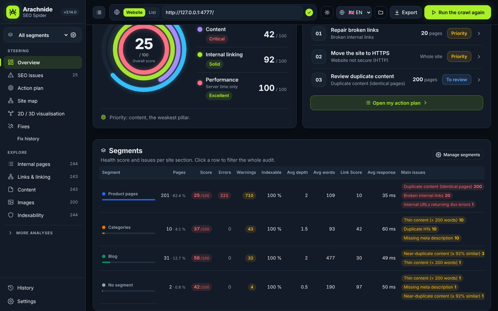
</p>

## 🤝 Novidades da 3.13: ligue o seu próprio agente de IA (Claude, ChatGPT…) ao Arachnide

O Arachnide passa a ser os olhos e as mãos do seu agente SEO / GEO. O agente lê a auditoria que tem aberta, inicia crawls que aparecem em direto na aplicação, explora as páginas, obtém o plano de ação priorizado e o novo relatório de **preparação GEO**, e corrige o site com a sua aprovação.

- **Três vias, 25 ferramentas**: MCP por stdio (Claude Code, Claude Desktop), **MCP por HTTP** (`/mcp`, para os conectores personalizados do claude.ai e os agentes alojados) e **REST + OpenAPI 3.1** (`/api/agent/*`, `/openapi.json` — a importar com um clique como Action do ChatGPT). As mesmas ferramentas em todo o lado, definidas uma só vez.
- **Token de acesso** criado no primeiro arranque, visível e renovável em *Definições → Agentes de IA*, com excertos prontos a colar (configuração do Claude Desktop, definições da Action do ChatGPT, pedido de teste), um campo de URL público para os túneis (cloudflared, ngrok, Tailscale) e o registo das últimas chamadas dos agentes.
- **Novas ferramentas**: `arachnide_action_plan` (o plano ordenado da app, com os ganhos rápidos assinalados), `arachnide_search_pages` (filtrar e ordenar as páginas por Link Score, profundidade, estado, pasta, problema), `arachnide_geo_readiness` (acesso dos robôs de IA, llms.txt, dados estruturados, profundidade do conteúdo → pontuação de 0-100 e recomendações), `arachnide_start_crawl` + `arachnide_crawl_status` (crawl em segundo plano, visível em direto na app). `crawl_id: "current"` designa sempre a auditoria aberta na app.
- Guia e instruções de sistema sugeridas para um agente SEO / GEO: [docs/AGENTS.md](docs/AGENTS.md).

## 🎨 Novidades da 3.12: uma revisão de design em toda a aplicação

Uma auditoria completa de UX, cores e tipografia de cada página, nos dois temas, no computador e no telemóvel, e depois as correções.

- **Uma tipografia a sério**: o tipo de letra Inter Variable passa a vir incluído (offline, licença SIL OFL), pelo que cada espessura aparece igual em todas as máquinas; 23 tamanhos de texto dispersos tornam-se uma escala de 8 níveis, com títulos, raios e espaçamentos coerentes.
- **Tema claro legível**: todos os textos coloridos (avisos, estados OK, ligações, etiquetas secundárias, selos de esforço) atingem agora o contraste WCAG AA (4,5:1) sobre os fundos em que estão colocados: 103 falhas medidas reduzidas a 0.
- **Detalhes mais cuidados**: a página «Correções» funciona com um rastreio aberto a partir de um ficheiro; o painel de detalhe da página já não fica visível nas páginas sem tabela; a linha selecionada de uma tabela é assinalada de forma limpa; o botão do tema mostra o que vai fazer; o interruptor de simulação voltou a estar visível.

## 🧭 Novidades da 3.11: mapa do site e visualização 2D / 3D, lado a lado

- **Mapa do site** (barra lateral): o mapa clássico ao estilo Screaming Frog — fundo branco, árvore horizontal, pensado para capturas de ecrã e relatórios para clientes.
- **Visualização 2D / 3D** (novo separador, logo abaixo): a vista de exploração — estilo escuro, disposição radial, em 2D ou 3D, colorida por problemas SEO por predefinição.
- As duas vistas partilham os mesmos dados, filtros, pesquisa e inspetor de página; cada uma guarda as suas próprias definições.

## 🌳 Novidades da 3.10: uma cartografia clássica, pronta a mostrar

Uma cartografia mais legível, para mostrar tal como está a um cliente ou a um responsável — e um controlo mais fino do que rastreia e cartografa.

<p align="center">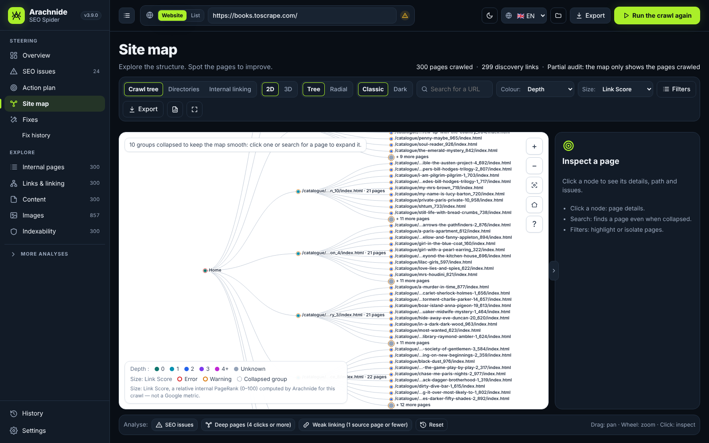</p>

- **Estilo clássico (novo por omissão)**: fundo branco, ligações finas, etiquetas escuras — no espírito da árvore de rastreio do Screaming Frog. O estilo *Escuro* continua a um clique, em 2D e em 3D.
- **Árvore horizontal**: a página inicial à esquerda, uma coluna por nível, uma etiqueta por página. As listas longas são resumidas («+ 28 páginas a mais», os problemas das páginas ocultas continuam assinalados) e *Mostrar a lista completa* expande-as; a página selecionada fica sempre visível. Em *Diretórios*, cada diretório mostra o seu caminho relativo ao diretório pai, como um explorador de ficheiros.
- **Exportações prontas a enviar**: o PNG / PDF passa a ter um cabeçalho (site, vista, data do rastreio, páginas apresentadas), a legenda e o contexto.
- **Nenhum URL inventado**: em *Diretórios*, uma página como `/en` passa a ter o seu diretório `/en/` em vez de mostrar ao lado um falso URL `/en/`; um diretório sem página no seu endereço é apresentado como um agrupamento (`/blog/page/*`).
- **Incluir / excluir URLs no mapa**: um padrão por linha — texto simples (`/en/`), caráter universal (`/en/*/page-*`) ou expressão regular (`/en/(.*)`). O filtro *Diretório* passa a funcionar em todos os níveis (`/en/blog/`).
- **Âmbito do rastreio**: incluir / excluir aceitam uma regex por linha, e a nova opção *Ficar no diretório inicial* rastreia apenas abaixo do diretório do URL inicial (como desmarcar «Crawl Outside of Start Folder» no Screaming Frog). Na linha de comandos: repita `--include` / `--exclude` e acrescente `--stay-in-folder`.
- **Mais robusto**: um URL inicial inválido (`htp:/x`, `javascript:…`, um simples número) é recusado com uma mensagem clara, os números absurdos são trazidos de volta a limites seguros e um rastreio que não pode ser guardado di-lo. Novos testes de ponta a ponta e «macaco» controlam a interface real num navegador (cliques ao acaso, entradas absurdas, redimensionamentos) em cada execução dos testes.

## 🕸️ Novidades da 3.9: uma cartografia mais rápida e mais legível

Explore a estrutura e identifique as páginas a melhorar, em 2D ou 3D, em milhares de páginas.

<p align="center">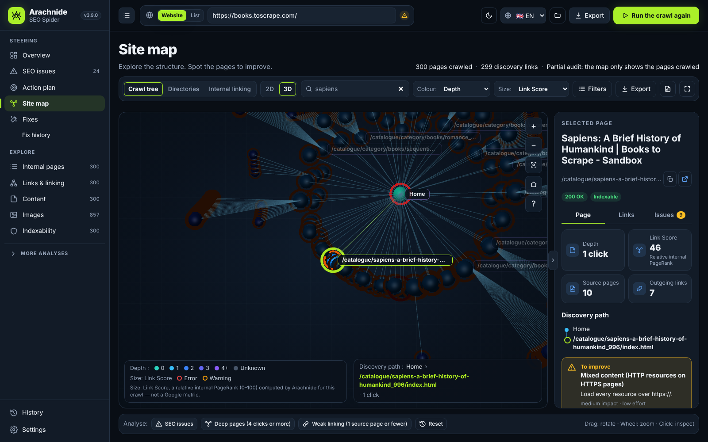</p>

- **Três vistas realmente diferentes**: *Árvore de rastreio* (cada página sob a página a partir da qual foi alcançada pelo caminho mais curto desde a página inicial — o caminho mostrado corresponde sempre à profundidade em cliques), *Diretórios* (caminhos de URL, com pastas virtuais que não contam como páginas) e *Ligação interna* (as ligações realmente observadas, com sentido e ciclos).
- **Inspetor de página**: estado, indexabilidade (apenas quando conhecida), profundidade, Link Score, páginas de origem, ligações de saída, caminho de descoberta, problemas e recomendação existente, com *Isolar o ramo / a vizinhança*, *Ver as ligações internas* e *Ver o plano de ação*.
- **Pesquisa, filtros e análises** sobre todas as páginas rastreadas (não apenas as desenhadas): problemas SEO, profundidade, diretório, estado HTTP, indexabilidade, ligação de entrada fraca com limiar explícito, intervalo de Link Score — destacadas no contexto ou isoladas. As exportações (PNG, PDF, CSV) mantêm etiquetas, legenda e contexto; uma vista *Lista* permite usar tudo pelo teclado.
- **Muito mais rápida**: disposição determinista em vez de uma simulação física para as árvores, nós e ligações desenhados em poucos lotes, renderização apenas quando algo muda. Medido na mesma máquina (renderização por software): estabilização 3D de 5,5–13,9 s para 0,7–3,2 s, fluidez 3D em rotação de 1–11 para 46–60 imagens/s.

## 🗺️ Novidades da 3.8: um plano de ação com que trabalhar

O que corrigir, por que ordem e como, e em que ponto está.

<p align="center">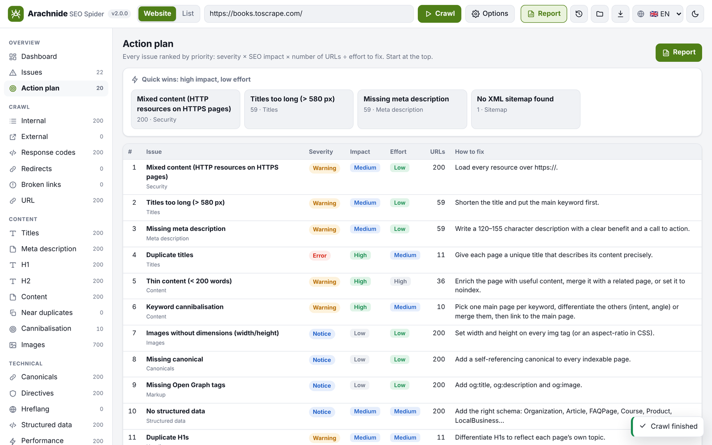</p>

- **Quatro cartões**: ações por tratar (por gravidade), ganhos rápidos (pouco esforço, impacto médio ou alto), esforço de correção e **Comece aqui**, a primeira ação da ordem recomendada.
- **Roteiro**: cada problema torna-se uma ação com um verbo claro, a sua posição, gravidade, impacto SEO, URL únicos, esforço e estado. Filtros (tudo, ganhos rápidos, a fazer, a verificar, outros estados), pesquisa e uma ordenação manual que substitui claramente a recomendada até voltar a ela.
- **Ficha da ação**: porquê começar aqui (apenas factos do rastreio), método numerado, critério «Concluído quando…», ver / exportar os URL, uma nota e **Iniciar esta ação → Marcar como concluída → Relançar o rastreio para validar**. Só um novo rastreio que já não deteta o problema o marca como resolvido.
- **Acompanhamento** (estado e notas) guardado no seu navegador para cada site; a seleção múltipla permite exportar os URL de várias ações ou mudar o estado de uma só vez.

## 🧭 Novidades da 3.7: uma página de problemas SEO mais clara

Do diagnóstico à correção num só ecrã: o que foi detetado, o que corrigir primeiro, a gravidade, quantos URL são afetados e o esforço estimado.

<p align="center">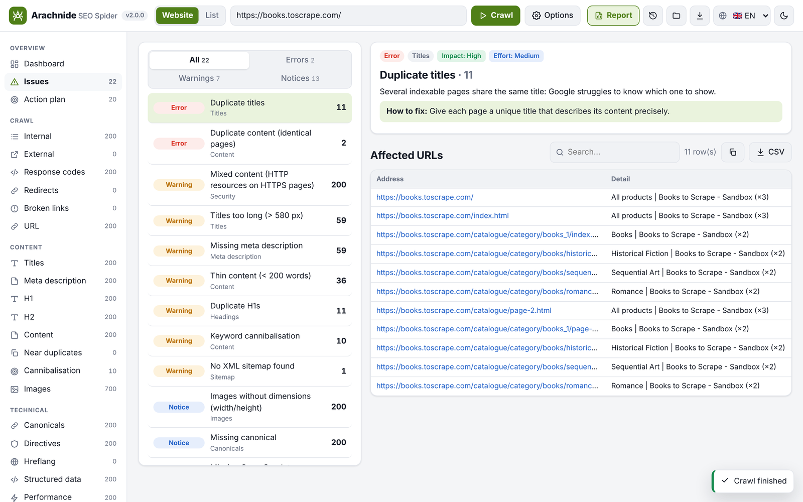</p>

- **Cartões de resumo**: tipos de problemas no total, erros, avisos e notas (nunca uma soma de URL). Um clique num cartão filtra a lista.
- **Lista priorizada**: separadores por gravidade, pesquisa e ordenação (prioridade recomendada por predefinição, com a regra explicada). URL únicos por problema, esforço separado da gravidade, paginação e navegação por teclado.
- **Painel de correção**: porquê corrigir, passos numerados, exemplo antes / depois retirado de uma página real (com uma sugestão automática claramente indicada para títulos e descrições demasiado longos), pré-visualização dos URL, **Ver os N URL** e **Exportar a lista**.
- **Os erros vêm sempre primeiro** na prioridade recomendada, no plano de ação e na visão geral.
- Duas colunas em ecrãs grandes, vista de detalhe dedicada no telemóvel.

## 🌙 Novidades da 3.6: painel em modo escuro

A visão geral responde num relance a uma pergunta: como está o meu site e o que fazer a seguir? (captura no topo desta página)

- **Saúde SEO em quatro anéis**: Técnico, Conteúdo, Ligação interna e Desempenho. Cada arco corresponde exatamente à pontuação do pilar; um clique abre os problemas correspondentes. Um pilar sem dados é indicado como «Não medido».
- **As suas prioridades**: as 3 primeiras ações, contadas em páginas únicas, com uma ligação para o plano de ação.
- **Indicadores-chave**, **O que funciona bem** e **O seu próximo objetivo**, além de um aviso quando a auditoria é parcial.
- Nova barra lateral (Gestão / Exploração), barra superior com o estado do rastreio e «Relançar o rastreio», tema escuro por predefinição.

## ✨ Novidades da 3.5: corrigir em 1 clique com o Claude ou o ChatGPT

Depois de um rastreio, o separador **Corrigir em 1 clique** agrupa os problemas por impacto, com a etiqueta **Corrigível com IA**, **Automática** ou **Manual**.

- **Corrigir** / **Corrigir tudo**: o Claude ou o ChatGPT escreve titles, meta descriptions, H1, textos alternativos e JSON-LD na língua da página (o custo estimado é mostrado antes). Os redirecionamentos 301 dos 404 internos, as canonicals, os noindex acidentais e os links para redirecionamentos são calculados sem IA.
- **Revisão**: antes / depois lado a lado, contador de caracteres, edição direta, Validar / Gerar de novo / Ignorar.
- **Aplicação** no WordPress (plugin complementar), através de um pull request do GitHub (Lovable, Bolt.new, React, Next.js, Astro, HTML) ou exportação CSV / JSON / PDF. **O modo de simulação está ativo por predefinição.**
- Cada URL corrigido é **rastreado de novo** (verificado ✓) e o **Histórico de correções** permite anular uma correção ou um lote inteiro.

Configuração (chave de IA, palavra-passe de aplicação do WordPress, token do GitHub): consulte o [README (EN)](README.md#-new-in-35-fix-in-1-click-with-claude-or-chatgpt) e [docs/CONNECTORS.md](docs/CONNECTORS.md).

<p align="center">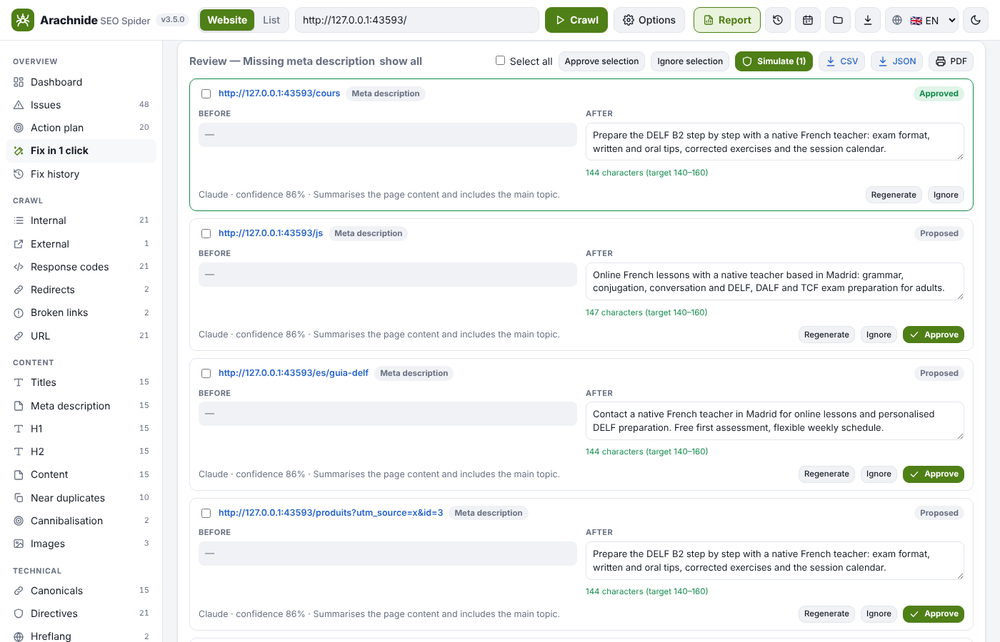</p>

## 🔎 Novidades da 3.4: fiabilidade até ao fim

- **Redirecionamentos JavaScript** detetados na renderização: tratados como redirecionamentos, destino rastreado.
- **Links agrupados por página e destino**, com todas as âncoras, em vez de uma linha por âncora.
- **Comparação de rastreios URL a URL**: «corrigido» só se o URL foi rastreado de novo sem o problema, com um aviso quando os dois rastreios não são comparáveis.
- **Versões hreflang rastreadas e verificadas**: destinos com erro, redirecionados ou não indexáveis assinalados.

## 🛡️ Novidades da 3.3: auditoria de fiabilidade

Uma auditoria completa (extração HTML, motor de rastreio, regras SEO e rastreios de 8 sites reais) eliminou os falsos positivos e falsos negativos que podiam enganar um profissional de SEO ou GEO.

- **Sites protegidos contra robôs** (403 no user-agent do rastreador): o rastreio muda automaticamente para o Chrome e indica-o, em vez de mostrar todas as páginas com erro.
- **Limitação de taxa (429/503)**: o Arachnide espera e tenta de novo; as páginas travadas já não contam como partidas. Os links para o LinkedIn ou sites protegidos pela Cloudflare são «não verificáveis», não «partidos».
- **Diretivas lidas como o Google**: `max-image-preview:none` não é um noindex, o `X-Robots-Tag` de outro robô é ignorado, o meta refresh é um redirecionamento.
- **O conteúdo tal como é**: `<title>` dos SVG ignorados, `alt=""` = imagem decorativa, imagens em lazy-load (`data-src`) analisadas, contagem de palavras em chinês, japonês e tailandês.
- **Internacional e dados estruturados**: hreflang verificados com os verdadeiros códigos ISO, traduções e páginas paginadas não são duplicados, só são verificadas as propriedades schema.org exigidas pelo Google.
- **Uma pontuação de saúde mais justa**: um link partido no menu já não deixa o site em 0, e um site que bloqueia o Googlebot já não obtém um A.
- **Novas verificações**: soft 404, canonical fora do `<head>`, sitemap noutro host, URLs não verificáveis.

## 📈 Novidades da 3.2: dados Google e rastreios agendados

- **Core Web Vitals de utilizadores reais** (PageSpeed Insights + CrUX: LCP, INP, CLS…) e pontuação Lighthouse das suas páginas principais.
- **Google Search Console**: cliques, impressões, CTR e posição por URL, via API ou importação do CSV. Encontra também **páginas que o Google conhece mas que os seus links não alcançam**, CTR baixos e páginas não indexáveis com tráfego.
- **Rastreios agendados** (diários / semanais / mensais) com **alertas por email** quando a pontuação desce ou surgem erros, com o relatório completo em anexo.

Configuração em 5 minutos: **[docs/GOOGLE-AND-SCHEDULES.md](docs/GOOGLE-AND-SCHEDULES.md)** (em inglês).

## 🤖 Novidade na 3.0: o Claude audita **e corrige** o seu site (MCP)

O Arachnide agora inclui um **servidor MCP**. Ligue-o ao Claude (Claude Code ou Claude Desktop) e peça em linguagem simples: *“Audite www.meu-site.pt e corrija os títulos, as descrições e os textos alternativos em falta das páginas mais importantes.”* O Claude vai:

1. **detetar** o CMS (WordPress, Shopify, Wix, Squarespace, Webflow, Joomla, Drupal, PrestaShop, site estático, Next.js…);
2. **rastrear e auditar** o site com o Arachnide;
3. **redigir** valores melhores a partir do conteúdo real de cada página (títulos únicos dentro do limite de píxeis do Google, descrições, textos alternativos, canónicas, redirecionamentos para URLs partidos);
4. mostrar uma **pré-visualização antes / depois** e aguardar a sua aprovação;
5. **aplicar** as alterações aprovadas no site em produção através da API do CMS, **verificá-las** e permitir **desfazer** qualquer lote;
6. **rastrear novamente** e mostrar a melhoria da pontuação.

| Como as correções são aplicadas | Plataformas | Quota do total de sites* |
|---|---|---:|
| API do CMS (+ pequeno plugin WordPress) | WordPress, Shopify, Wix, Joomla, Webflow, Drupal, PrestaShop | ≈ 53% |
| Ficheiros HTML ou Cloudflare Worker | sites sem CMS (à medida, estáticos, Next.js, Hugo…) e qualquer site atrás da Cloudflare | até 31,6% |
| Instruções passo a passo | Squarespace e outros construtores fechados | o resto |

<sub>* W3Techs, outubro de 2026.</sub>

```bash
claude mcp add arachnide -- node /path/to/arachnide-seo-spider/src/mcp.mjs
```

Segurança em primeiro lugar: pré-visualização antes de cada escrita, pedido de autorização para cada escrita, regras por site (campos permitidos, tamanho dos lotes, só leitura), um registo de todos os valores anteriores com reversão numa única chamada, e credenciais que nunca passam pelo chat. **Guia completo (em inglês): [docs/MCP.md](docs/MCP.md)**.

## 🆕 Novidades da versão 2.1

| | |
|---|---|
| 🕸️ **Visualizações 2D e 3D** | Veja a arquitetura do site em 2D ou 3D, em três vistas: **árvore de rastreio** (caminho de cliques mais curto a partir da página inicial), **diretórios** (estrutura dos URLs) e **links** (todos os links internos seguidos). Colore os nós por indexabilidade, problemas SEO ou profundidade; o tamanho do nó mostra o Link Score. Clique num nó para ver os detalhes da página e exporte a vista em PNG para os seus relatórios. |
| ⚙️ **Configuração do crawler, como no Screaming Frog** | Uma janela de **Configuração** com separadores: Spider, **Limites**, **Velocidade**, **robots.txt**, Renderização, Incluir / excluir, Extração, Autenticação. Mantém apenas as definições que importam. |
| 🚧 **Spider › Limites** | Total de rastreio, profundidade de rastreio, URLs por profundidade, profundidade de pastas, número de parâmetros de consulta, redirecionamentos a seguir, comprimento do URL, links por página, tamanho da página e **limites por caminho de URL** (`/blog/ = 200`). O painel mostra quantos URLs cada limite deixou de fora. |
| 🤖 **robots.txt** | Três modos: **respeitar**, **ignorar mas assinalar** (rastreia os URLs bloqueados e continua a assinalá-los) e **ignorar**. Cole um **robots.txt personalizado** para testar um novo ficheiro antes de o publicar e use o **testador** integrado para ver se um URL é permitido e que regra se aplica. |
| 🐢 **Velocidade** | Número máximo de threads e um limite global de **URLs por segundo**, para proteger servidores frágeis. |
| 🧲 **Extração personalizada** | Recolha quaisquer dados de cada página com um seletor CSS ou uma regex: preço, autor, data, SKU, código de acompanhamento… Os resultados aparecem num separador **Extração** e na exportação CSV. |
| 🔐 **Autenticação e limpeza de URLs** | Autenticação HTTP e cabeçalhos ou cookies personalizados para sites de pré-produção. Só são enviados para o site auditado e a palavra-passe nunca é guardada. **Remova parâmetros de URL** como `utm_*`, `gclid` ou `fbclid` para evitar URLs duplicados. |

<p align="center">
  
</p>

## ✨ Novidades da versão 2.0

| | |
|---|---|
| 🌍 **6 idiomas** | A aplicação, as exportações CSV e os relatórios estão disponíveis em inglês, francês, alemão, espanhol, italiano e português, com um seletor de idioma no cabeçalho. |
| ⚙️ **Renderização JavaScript** | Audita sites em React, Vue, Angular e Next.js tal como o Google os vê. O Arachnide usa o Chrome ou o Edge já instalado no seu computador, por isso não é transferido mais nada. Compara o HTML bruto com a página renderizada e mede o **LCP e o CLS**. |
| 📄 **Relatórios SEO profissionais** | Um relatório de auditoria em marca branca com o seu logótipo, a sua cor e os seus contactos. Contém um resumo executivo, as principais conclusões, pontuações por categoria, um plano de ação com prioridades, uma análise detalhada e a **evolução desde a última auditoria**. Imprima-o em PDF com um clique. [Ver um exemplo de relatório (PDF)](docs/sample-report.pdf). |
| 🎯 **Plano de ação** | Cada problema é ordenado por gravidade × impacto × número de URLs ÷ esforço, e as vitórias rápidas são destacadas. |
| 🧠 **Novas análises SEO** | PageRank interno (Link Score), conteúdo quase duplicado (simhash), canibalização de palavras-chave, largura do título e da descrição em píxeis, links contextuais vs links de menu e rodapé, âncoras genéricas, hierarquia de cabeçalhos, dados estruturados incompletos, validação hreflang, compressão, HSTS e muito mais. |
| 🤖 **IA e GEO** | Mostra se o ChatGPT, o Claude, o Perplexity, o Google-Extended e outros crawlers de IA conseguem aceder ao site, e se este tem um ficheiro `llms.txt`. |
| 📋 **Modo lista** | Audite apenas uma lista de URLs que colar, sem seguir links. |
| 🔎 **Pesquisa personalizada** | Encontre todas as páginas que contêm um texto ou uma regex, como um número de telefone antigo ou um código de tracking. |
| 🎨 **Novo design** | Ecrã inicial com os rastreamentos recentes, progresso em direto com velocidade e tempo restante, painel de detalhe redimensionável, navegação por teclado (↑ ↓ Enter, `/` para pesquisar), notificações e modo escuro. |

## 🔍 Tudo o que o Arachnide verifica

| Área | Verificações |
|---|---|
| **Códigos de resposta** | 2xx / 3xx / 4xx / 5xx, tempos limite esgotados, URLs bloqueados pelo robots.txt, links internos e externos partidos |
| **Redirecionamentos** | Cadeias, ciclos, redirecionamentos temporários 302/307, meta refresh, redirecionamentos para a página inicial (soft 404), links internos que apontam para redirecionamentos |
| **Títulos e metas** | Em falta, duplicados, demasiado longos (em píxeis), demasiado curtos ou múltiplos; título idêntico ao H1; pré-visualização da SERP do Google |
| **Cabeçalhos** | H1 em falta, duplicado ou múltiplo; sem H2; níveis de cabeçalho saltados |
| **Conteúdo** | Número de palavras, conteúdo pobre, duplicados exatos e quase duplicados, canibalização de palavras-chave, palavra-chave principal por página, rácio de texto |
| **Imagens** | Texto alternativo em falta, imagens pesadas, imagens partidas, width/height em falta (CLS), cada ficheiro de `srcset` e `<picture>` verificado (peso, estado, formato), sem versão responsiva, sem WebP / AVIF, `srcset` sem `sizes` |
| **Indexação** | Canónicos (em falta, múltiplos, a apontar para um URL não indexável), noindex, nofollow, X-Robots-Tag |
| **Arquitetura** | Profundidade de clique, Link Score (PageRank interno), páginas órfãs, páginas com um único link de entrada ou sem link contextual, páginas inacessíveis |
| **Sitemaps** | Sitemap em falta, URLs não indexáveis no sitemap, páginas indexáveis ausentes do sitemap |
| **Internacional** | Códigos hreflang inválidos, links de retorno em falta, autorreferência em falta, x-default em falta |
| **Dados estruturados** | Tipos encontrados (JSON-LD, microdados), JSON-LD inválido, propriedades em falta para resultados enriquecidos (Article, Product, FAQPage, LocalBusiness, Course, Event…) |
| **JavaScript** | Conteúdo, links, título, H1, canónico ou noindex alterados pelo JavaScript; erros JS; LCP e CLS |
| **Desempenho e segurança** | Tempo de resposta, tamanho do HTML, compressão, HTTPS, HSTS, conteúdo misto |
| **URLs** | Letras maiúsculas, underscores, parâmetros, acentos, comprimento |
| **IA e GEO** | Acesso para Googlebot, Bingbot, GPTBot, OAI-SearchBot, ClaudeBot, PerplexityBot, Google-Extended…; llms.txt |

## 📸 Capturas de ecrã

| Problemas com correções | Plano de ação com prioridades |
|---|---|
|  |  |
| **Pré-visualização da SERP do Google (largura em píxeis)** | **Links internos, Link Score e links de entrada** |
| 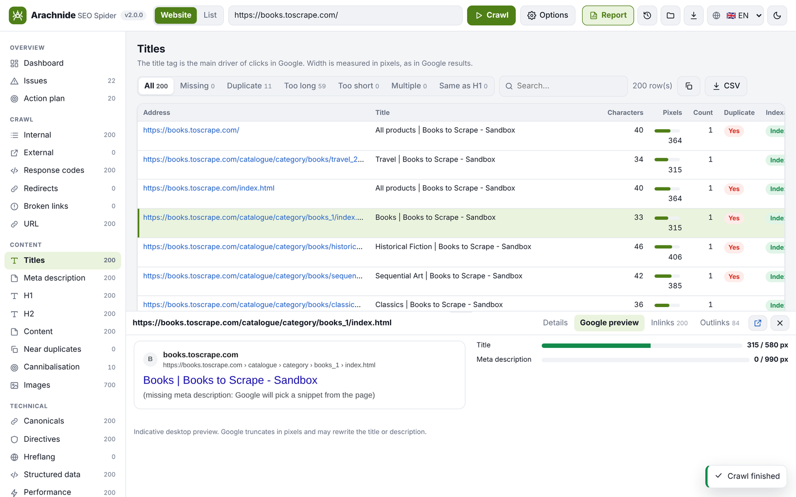 | 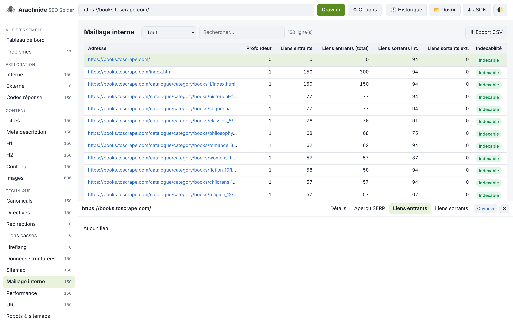 |
| **Definições do relatório em marca branca** | **Relatório de auditoria profissional** |
| 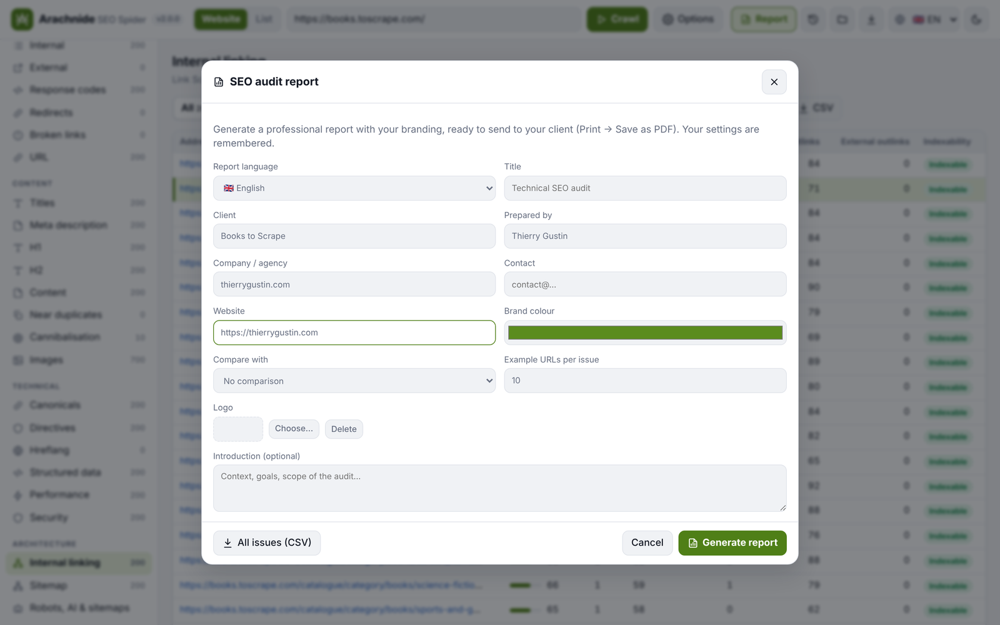 | 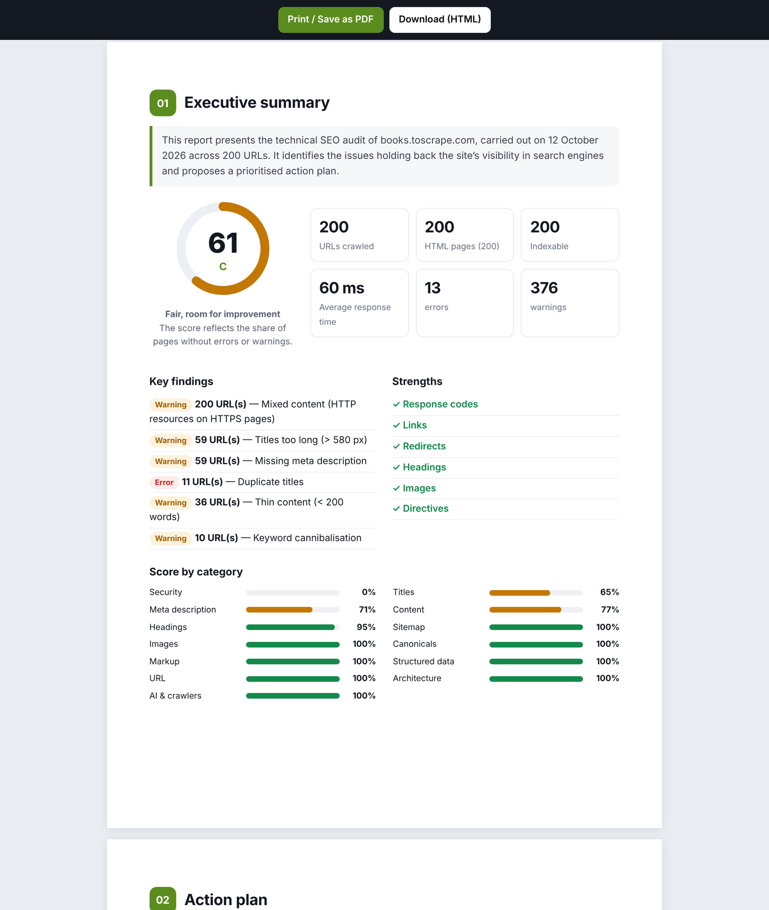 |
| **Árvore de rastreio (2D)** | **Grafo de links (2D)** |
| 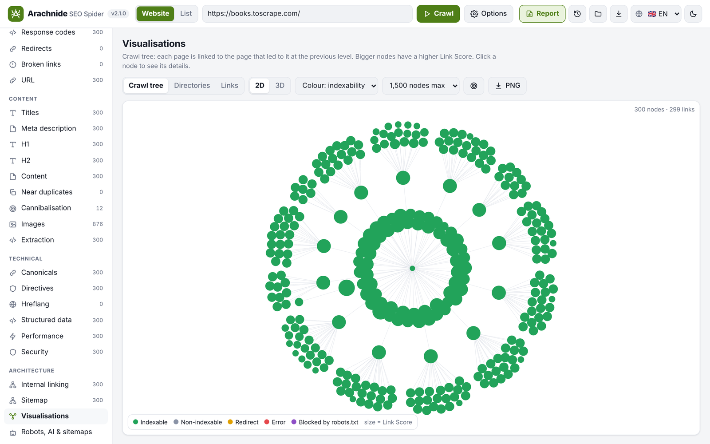 | 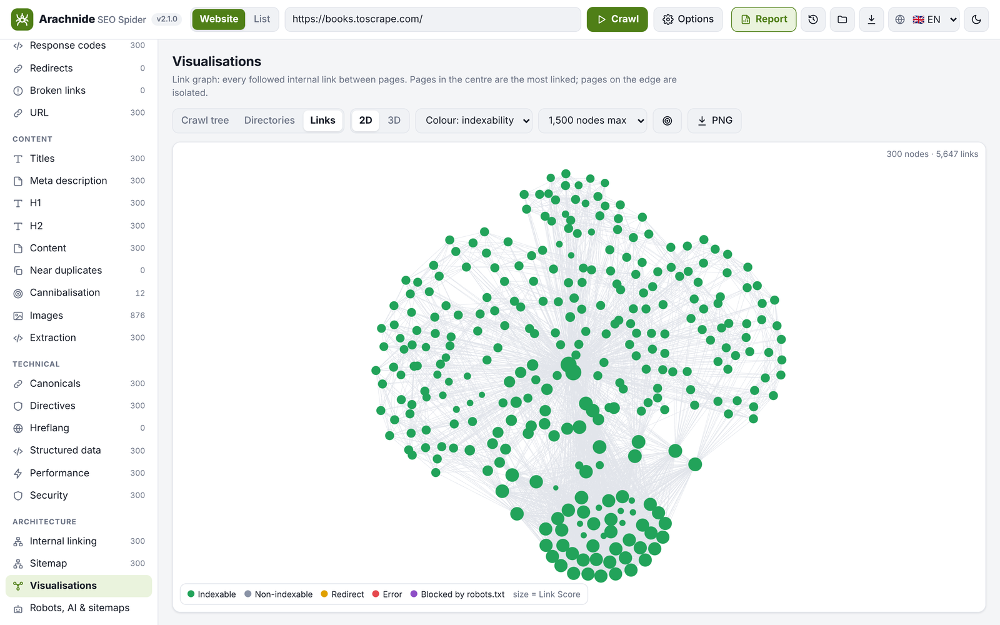 |
| **Diretórios** | **Extração personalizada** |
| 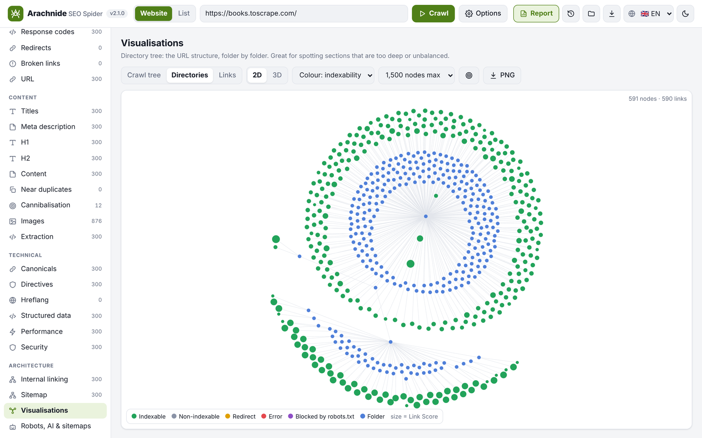 | 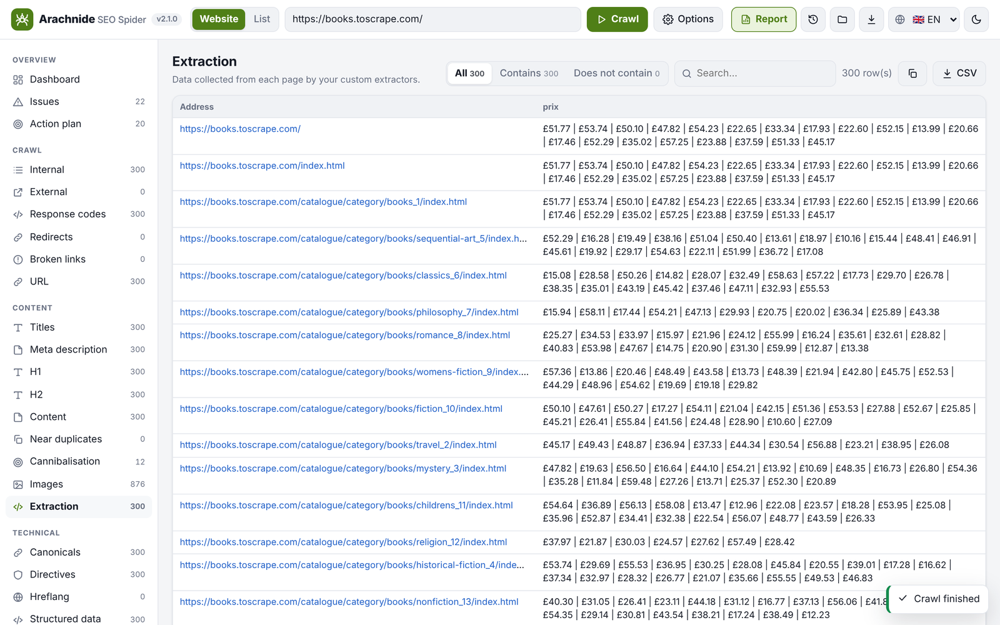 |
| **Configuração › Limites** | **Configuração › robots.txt (com testador)** |
| 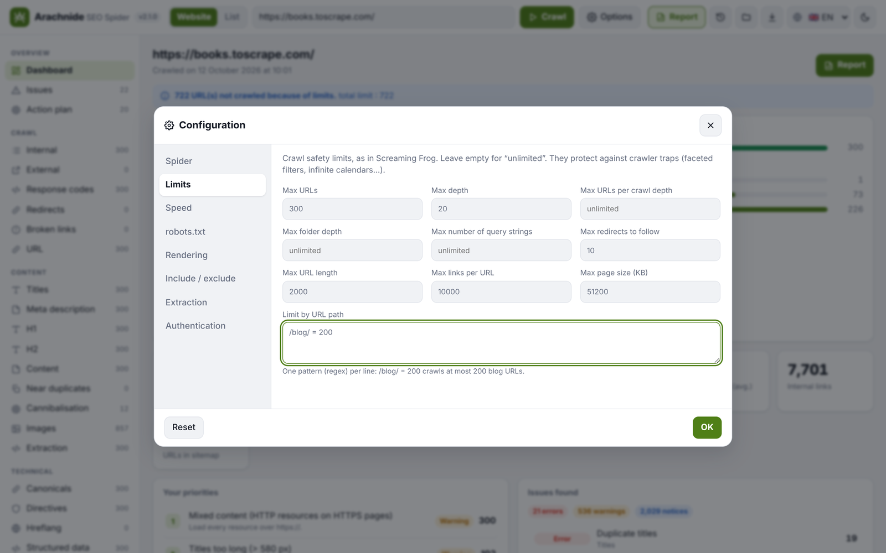 | 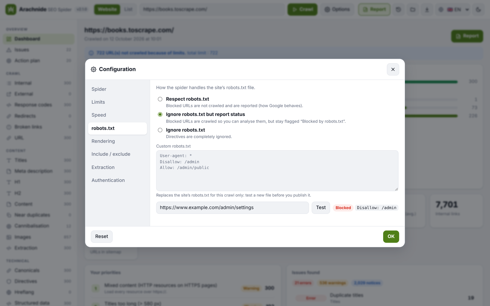 |
| **Ecrã inicial** | **Modo escuro** |
| 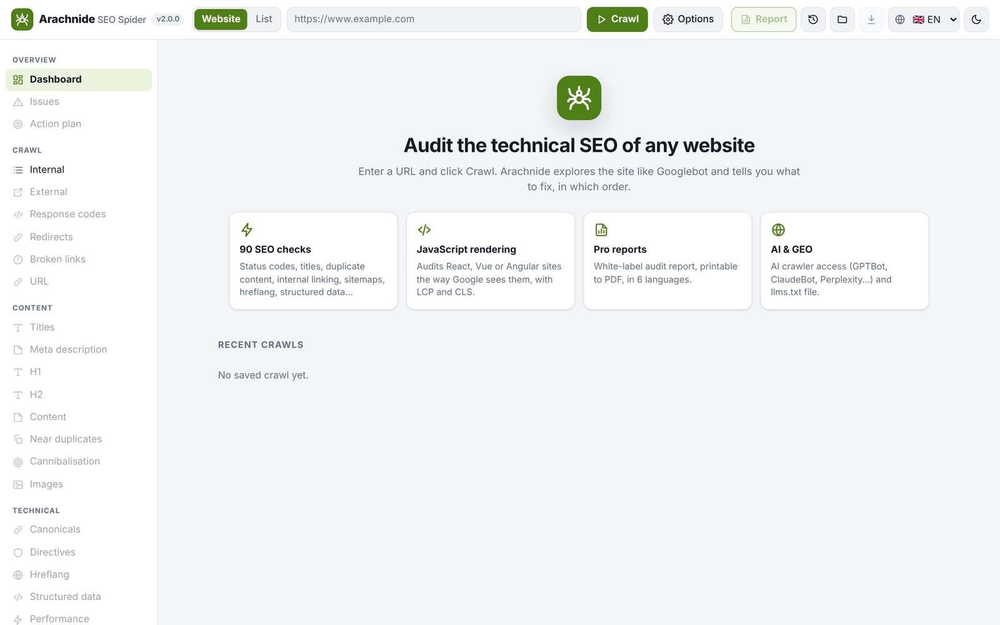 | 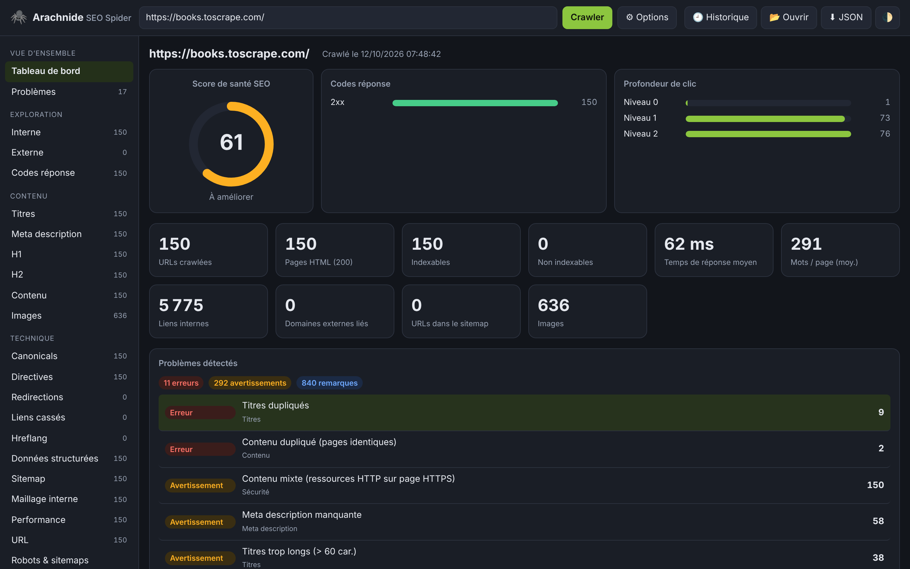 |

## 🚀 Instalação

### 1. Instalar o Node.js

Transfira a versão **LTS** em **[nodejs.org](https://nodejs.org)** e instale-a como qualquer outro programa. Precisa da versão 18.17 ou mais recente; recomenda-se a LTS mais recente. Para verificar a sua versão, abra um terminal e escreva `node -v`.

Para a **Renderização JavaScript**, precisa também de ter instalado o Google Chrome, o Microsoft Edge, o Chromium ou o Brave. O Arachnide encontra o navegador automaticamente.

### 2. Transferir o Arachnide

- **A forma mais simples:** clique no botão verde **`<> Code`** no topo desta página, depois em **Download ZIP**, e descomprima o ficheiro.
- **Com Git:**
  ```bash
  git clone https://github.com/Jacckisback/arachnide-seo-spider.git
  ```

### 3. Iniciar

**Opção A: duplo clique.** O lançador instala ou atualiza tudo e depois abre o seu navegador.

| Sistema | Ficheiro para fazer duplo clique |
|---|---|
| macOS | `start-mac.command`. Na primeira vez, clique com o botão direito e escolha **Abrir**, porque o macOS bloqueia scripts não assinados. |
| Windows | `start-windows.bat` |
| Linux | `start-linux.sh` |

**Opção B: terminal**

```bash
cd arachnide-seo-spider
npm install
npm start
```

Depois abra **http://localhost:4000**. Escreva o endereço de um site e clique em **Rastrear**.

Mantenha a janela do terminal aberta enquanto usa a aplicação e prima `Ctrl + C` para a parar. Se a porta 4000 estiver ocupada, o Arachnide escolhe a próxima porta livre e mostra-a no terminal.

**Atualizar a partir da 1.x:** transfira a nova versão (ou execute `git pull`) e depois execute novamente `npm install`. Os lançadores de duplo clique fazem isto por si.

## 📄 Criar um relatório para um cliente

1. Rastreie o site.
2. Clique em **Relatório**. Escolha o idioma do relatório e depois adicione o seu logótipo, a cor da sua marca, o nome do cliente e os seus contactos. As suas definições ficam guardadas.
3. Opcionalmente, escolha um **rastreamento anterior do mesmo site** para mostrar a evolução: variação da pontuação, problemas corrigidos e novos problemas.
4. Clique em **Gerar relatório** e depois em **Imprimir / Guardar como PDF**.

Use **Todos os problemas (CSV)** para dar ao seu cliente ou programador a lista completa de URLs a corrigir.

## ⚙️ Configuração

Clique em **⚙ Opções** para abrir a janela **Configuração**. As suas definições ficam guardadas, exceto a palavra-passe.

| Separador | Definições |
|---|---|
| Spider | Ler sitemaps XML, seguir canónicos, incluir subdomínios, verificar links externos e imagens |
| Limites | Total de rastreio, profundidade de rastreio, URLs por profundidade, profundidade de pastas, parâmetros de consulta, redirecionamentos a seguir, comprimento do URL, links por página, tamanho da página, limites por caminho de URL (`/blog/ = 200`, um por linha) |
| Velocidade | Número máximo de threads, máximo de URLs por segundo, tempo limite |
| robots.txt | Respeitar robots.txt / Ignorar robots.txt mas assinalar o estado / Ignorar robots.txt, robots.txt personalizado, testador de URLs |
| Renderização | Renderização JavaScript, user-agent (Arachnide, Googlebot desktop/smartphone, Chrome), Accept-Language |
| Incluir / excluir | Regex de inclusão / exclusão, remover parâmetros de URL (`utm_*, gclid`), ignorar todos os parâmetros, pesquisa personalizada |
| Extração | Até 20 extratores: seletor CSS (texto, atributo, HTML ou contagem) ou regex |
| Autenticação | Utilizador e palavra-passe HTTP, cabeçalhos personalizados (cookies, tokens) |

Use o seletor **Site / Lista** junto ao campo de endereço para rastrear um site inteiro ou apenas uma lista de URLs.

## 🕸️ Visualizações

Depois de um rastreio, abra **Visualizações** na barra lateral:

- **Árvore de rastreio:** cada página está ligada à página que levou até ela no nível de profundidade de clique anterior. Ramos longos significam páginas profundas.
- **Diretórios:** a estrutura dos URLs, pasta a pasta. Mostra secções desequilibradas ou demasiado profundas.
- **Links:** o grafo completo dos links internos. As páginas bem ligadas agrupam-se no centro e as páginas isoladas afastam-se para a periferia.

Alterne entre **2D** e **3D**, colore por indexabilidade, problemas ou profundidade, escolha quantos nós mostrar (até 6000), clique num nó para abrir os seus detalhes e exporte um PNG para os seus relatórios.

## 🖥️ Linha de comandos

```bash
node src/cli.mjs https://www.example.com --max 2000 --csv --report --lang pt
node src/cli.mjs https://www.example.com --render --ua googlebotMobile --report --client "ACME" --author "Your name"
node src/cli.mjs --list urls.txt --lang de --csv
node src/cli.mjs --sitemap https://www.example.com/sitemap.xml --extract "price=.price" --extract "sku=xpath://meta[@itemprop='sku']/@content" --csv
npm run bench -- --pages 200000
node src/cli.mjs https://www.example.com --report --compare crawls/previous.jsonl.gz
node src/cli.mjs --resume crawls/.en-cours/www.example.com_2026-10-21T09-00-00.ndjson --csv
node src/cli.mjs https://www.example.com --max 20000 --segments segments.json --csv --report
node src/cli.mjs https://www.example.com --ga4-key ga4-key.json --ga4-property 123456789 --csv
node src/cli.mjs https://www.example.com --logs access.log --logs access.log.1.gz --logs-verify --csv --report
node src/cli.mjs --sitemap https://www.example.com/sitemap_index.xml --sitemap-previous crawls/previous.jsonl.gz --csv
node src/cli.mjs https://staging.example.com --auth user:pass --rate 2 --robots report --path-limit "/blog/=200" --extract "price=.price" --remove-params "utm_*,gclid"
node src/cli.mjs --help
```

A CLI mostra a pontuação e os problemas no seu idioma. Guarda o rastreamento em JSON, que pode abrir na interface com **📂**. Com `--csv` exporta também as páginas e os problemas, e com `--report` gera um relatório de auditoria HTML com a sua marca, que pode imprimir em PDF.

## 🛠️ Resolução de problemas

| Mensagem | Solução |
|---|---|
| `cd: no such file or directory` | Não está na pasta certa. Use `cd` seguido do caminho da pasta descomprimida, por exemplo `cd ~/Downloads/arachnide-seo-spider`. |
| `npm ERR! enoent … package.json` | Mesma causa: execute `npm install` **dentro** da pasta do Arachnide. |
| `--disable-warning= is not allowed in NODE_OPTIONS` | A sua shell define uma opção que a sua versão do Node não suporta. Execute `unset NODE_OPTIONS` (macOS/Linux) ou atualize o Node.js para a LTS mais recente. |
| A renderização JavaScript não está disponível | Instale o Google Chrome. Se estiver instalado num local pouco habitual, inicie o Arachnide com `CHROME_PATH="/path/to/chrome" npm start`. |
| Algumas páginas não mostram H1 nem conteúdo | O site provavelmente constrói o conteúdo com JavaScript. Ative a **Renderização JavaScript** nas opções. |

## 🧪 Desenvolvimento

```bash
npm test
```

Os testes rastreiam um pequeno site local com erros de SEO intencionais (`test/fixture-site.mjs`). Abrangem a renderização JavaScript, o modo lista, os relatórios em todos os idiomas e a completude das traduções. São executados no Node 18, 20 e 22 através do GitHub Actions.

```
src/
  crawler.mjs    crawl engine (queue, concurrency, robots.txt, sitemaps, redirects, list mode)
  renderer.mjs   JavaScript rendering with the installed Chrome / Edge (puppeteer-core)
  parse.mjs      HTML extraction (titles, metas, headings, links, images, schema, hreflang…)
  analyze.mjs    link graph, click depth, Link Score, duplicates, cannibalisation, SEO checks
  text.mjs       keywords, multilingual stop words, simhash
  pixel.mjs      title and description width in pixels
  options.mjs    validation of the crawl configuration (UI and CLI)
  server.mjs     local web server and API with live updates
  cli.mjs        command-line interface
public/
  app.js         web interface (no framework)
  viz.js         2D / 3D visualisations (force-graph, 3d-force-graph, served locally)
  i18n/*.js      translations (en, fr, de, es, it, pt)
  shared/        report generator, crawl comparison, robots.txt parser, i18n, icons (used by the UI and the CLI)
```

**Adicionar um idioma:** copie `public/i18n/en.js`, traduza os valores e adicione o idioma a `LANGS` em `public/shared/i18n.js`. O `npm test` verifica que não falta nenhuma chave nem nenhum marcador.

## 🗺️ Roteiro

- [ ] Dados de campo do PageSpeed Insights / CrUX
- [ ] Integração com o Google Search Console (cliques e impressões por URL)
- [ ] Rastreamentos agendados com alertas por e-mail
- [ ] Importação de uma exportação CSV do Google Search Console (páginas órfãs presentes apenas no GSC)
- [x] Extração personalizada (2.1)
- [x] Visualizações 2D / 3D da arquitetura do site (2.1)

Sugestões e pull requests são bem-vindos. Consulte [CONTRIBUTING.md](CONTRIBUTING.md).

## ⚖️ Utilização responsável

Rastreie apenas sites que lhe pertencem ou que está autorizado a auditar. Em sites de clientes, mantenha 2 a 5 pedidos simultâneos e adicione uma pausa em alojamento partilhado. A interface só escuta no seu computador (`127.0.0.1`).

---

## 🙏 Agradecimentos

O Arachnide não seria o que é sem as pessoas que dedicaram tempo a testá-lo, a desafiá-lo e a encorajá-lo, a maioria no X:

- [@Loran750](https://x.com/Loran750), por uma ajuda incrível, muito para além do que poderia ter esperado mesmo nos meus sonhos mais loucos, e por me ter motivado tanto.
- [@mrgris](https://x.com/mrgris), pelas recomendações sobre as verificações de imagens e por tanta motivação neste projeto.
- [@Mar1e](https://x.com/Mar1e), pela recomendação de integrar o Google Analytics 4.
- [@effi_10](https://x.com/effi_10), pelas recomendações sobre a segmentação.
- [@EmelineRoblot](https://x.com/EmelineRoblot), pelo desafio que me lançou: rastrear mais de um milhão de páginas sem falhar.
- [@absolute_web](https://x.com/absolute_web), pelos conselhos sobre a proteção de e-mails da Cloudflare e pelas atualizações da integração OpenAI com os modelos mais recentes.
- E, claro, os meus filhos, Oliver e Alberto, de longe a minha melhor criação e o meu maior orgulho.

## 👤 Autor

<table>
  <tr>
    <td width="140" align="center">
      
    </td>
    <td>
      <h3>Thierry Gustin</h3>
      <p><b>Consultor SEO</b> freelancer e professor de francês, a viver em <b>Madrid</b> 🇪🇸🇫🇷.<br>
      Criei o Arachnide para as minhas próprias auditorias de SEO técnico e partilho-o gratuitamente com a comunidade SEO.</p>
      <p>
        🌐 <a href="https://thierrygustin.com">thierrygustin.com</a> — auditorias e consultoria SEO<br>
        💼 <a href="https://www.linkedin.com/in/thierrygustin">LinkedIn</a><br>
        📚 <a href="https://laclassefrancaise.es">laclassefrancaise.es</a> · <a href="https://delfonline.es">delfonline.es</a> — cursos de francês e preparação para DELF / DALF / TCF
      </p>
      <p><b>Precisa de uma auditoria SEO completa ou de ajuda para corrigir os problemas que o Arachnide encontrou?</b> <a href="https://thierrygustin.com/contact">Entre em contacto →</a></p>
    </td>
  </tr>
</table>

Se o Arachnide lhe poupa tempo, uma ⭐ no GitHub ajuda muito!

## 📄 Licença

[MIT](LICENSE) © 2026 Thierry Gustin. Pode usá-lo, modificá-lo e partilhá-lo livremente, incluindo em trabalho comercial.

<sub>O Arachnide é um projeto independente, sem qualquer ligação à Screaming Frog Ltd. “Screaming Frog” é uma marca registada do respetivo proprietário.</sub>
